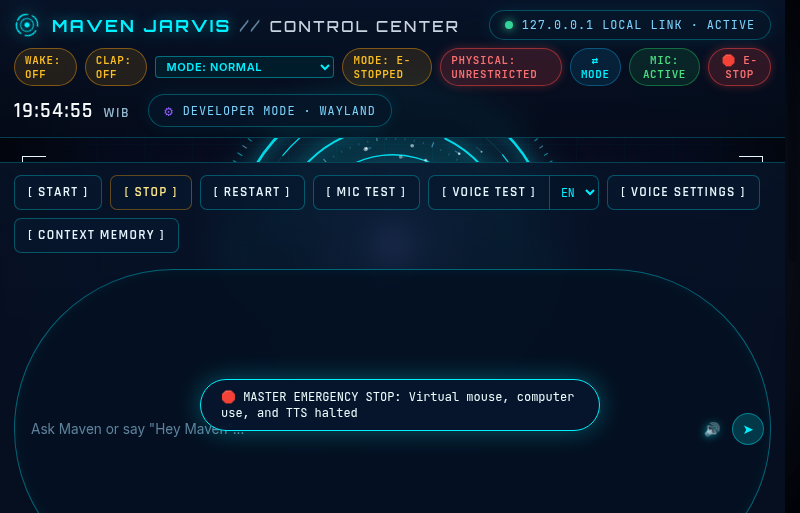
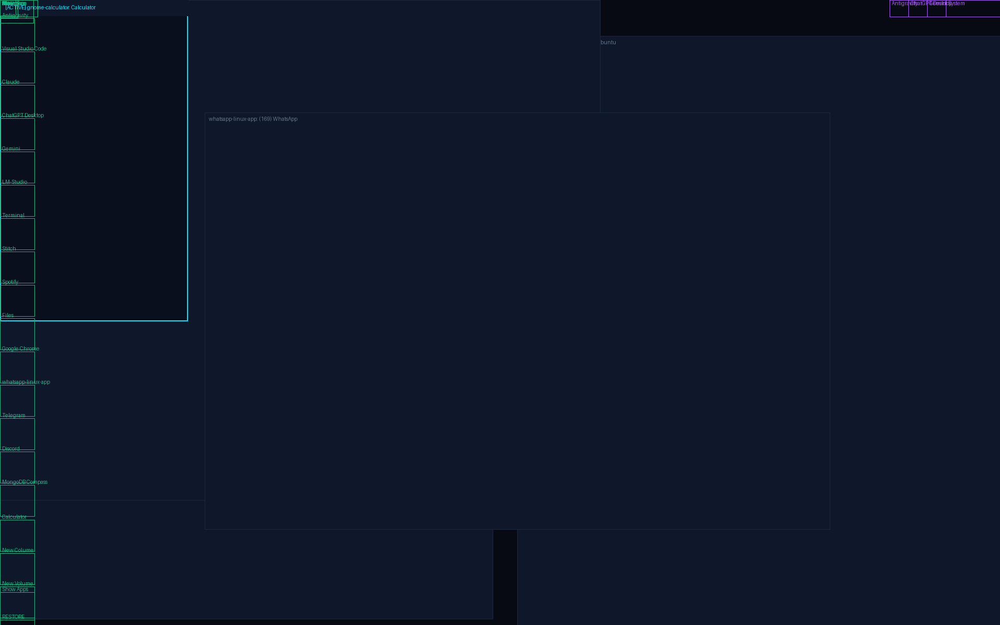
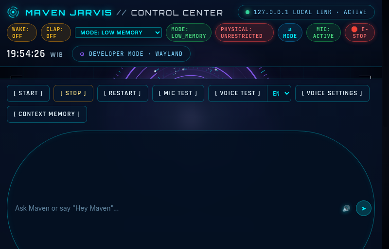
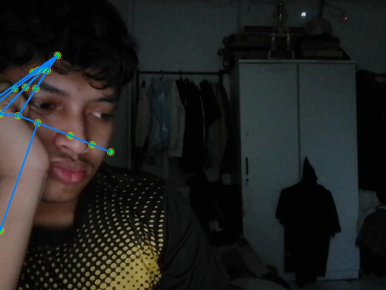
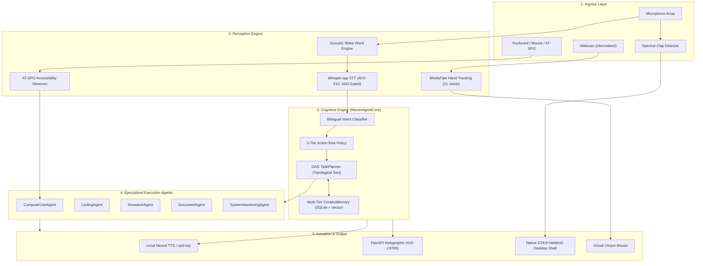

# MAVEN AI Agent — The Autonomous Linux Desktop J.A.R.V.I.S.

<div align="center">

```
   __  ______ _    _____________   __   ___    ____   ___                    __ 
  /  |/  /   | |  / / ____/ | / /  /  | / / |  / / /  /   | ____ ____  ____  / /_
 / /|_/ / /| | | / / __/ /  |/ /  / /| / /| | / / /  / /| |/ __ `/ _ \/ __ \/ __/
/ /  / / ___ | |/ / /___/ /|  /  / ___  / | |/ / /__/ ___ / /_/ /  __/ / / / /_  
/_/  /_/_/  |_|___/_____/_/ |_/  /_/  |_/  |___/____/_/  |_\__, /\___/_/ /_/\__/  
                                                          /____/                  
```

**Next-Generation Autonomous Linux Operating Agent, Voice Companion & Holographic HUD**

[](LICENSE)
[](https://python.org)
[-orange?style=flat-square&logo=linux)](https://ubuntu.com)
[](docs/TESTING.md)
[](docs/TESTING.md)
[](docs/TESTING.md)
[](docs/SECURITY.md)

[**Features**](#-key-features--capabilities) • [**Architecture**](#-system-architecture) • [**Screenshots**](#-visual-previews--screenshots) • [**Installation**](#-quick-start--installation) • [**Documentation**](#-comprehensive-documentation-system)

---

</div>

## 📌 Project Overview & Problem Statement

### The Problem
Traditional desktop assistants on Linux are either fragmented command-line utilities, sluggish web wrappers, or basic speech wrappers that suffer from:
1. **Severe Conversational Latency:** 15s to 60s delays caused by unoptimized LLM cascading and bloated prompts.
2. **Acoustic & STT Hallucinations:** Whisper models hallucinating nonsensical phrases when listening to ambient room noise or silence.
3. **No True OS Agency:** Inability to interact with native GUI applications, inspect accessibility trees, or run multi-step developer workflows safely.
4. **Accidental Triggers:** False wakeups triggered by typing, desk thuds, or keyboard impacts.

### The Solution: MAVEN JARVIS
**MAVEN** (Maverick Autonomous Virtual Ecological Navigator) is an offline-first, low-latency, autonomous operating agent modeled after Tony Stark's J.A.R.V.I.S. It unifies:
- **Instantaneous Voice Interaction:** Sub-1.8s TTFT conversational streaming with an authentic, calm J.A.R.V.I.S. persona ("Sir" / "Pak Firza").
- **Spectral Acoustic Clap Detection:** Dual-clap to open HUD and listen; single-clap to dismiss. Rejects desk knocks via real-time FFT high-frequency snap analysis.
- **Universal Linux Computer Use:** Native AT-SPI2 accessibility tree inspection with 5-tier fallback strategies (clicks, shortcuts, text injection).
- **DAG Task Planning:** Multi-step autonomous task execution with topological dependency ordering and 5-tier action risk gating.
- **Sci-Fi Holographic HUD:** Futuristic, lightweight FastAPI + WebSocket control center displaying real-time CPU, RAM, battery telemetry, and chat streams.

---

## 📸 Visual Previews & Screenshots

| Holographic Control Center HUD | Autonomous Computer Use In Action |
| :---: | :---: |
| <br/>*Real-time hardware gauges, voice interaction state, and autonomous task plan status.* | <br/>*Universal AT-SPI2 application tree inspection and autonomous GUI interaction.* |

| Voice Conversation & Workflow | MediaPipe 21-Landmark Vision Tracking |
| :---: | :---: |
| <br/>*Instantaneous voice interaction with live streaming sentence playback.* | <br/>*Real-time 21-joint 3D hand tracking and gesture-controlled virtual mouse pointer.* |

---

## ⚡ Key Features & Capabilities

### 1. Authentic J.A.R.V.I.S. Voice Experience
- **Bilingual Mastery:** Fluent, natural comprehension and speech in **Bahasa Indonesia** and **English**.
- **Acoustic Wake Word:** Local offline keyword detection ("Hey Maven", "Maven", "Halo Maven").
- **Silence VAD Gating:** Strict speech onset validation eliminates Whisper hallucinations on ambient silence.
- **Tone & Persona:** Calm, dignified, razor-sharp, and subtly witty—prioritizes immediate action over conversational fluff.

### 2. Physical & Acoustic Interaction (Spectral Clap Detector)
- **Dual Clap:** Two distinct claps in 180ms–750ms cadence opens the HUD and activates listening mode.
- **Single Clap:** Dismisses the HUD immediately and silences speech.
- **Spectral Discrimination:** Compares high-frequency snap energy (1.2 kHz – 5.5 kHz) against mechanical bass (< 900 Hz), completely ignoring table knocks, typing, and bumps.

### 3. Universal Desktop Automation & Accessibility (AT-SPI2)
- Traverses the native Linux AT-SPI2 widget hierarchy with $< 0.1$ ms node traversal latency.
- Executes clicks, scrolls, keyboard shortcuts, and text entry directly without physical mouse disruption.

### 4. 11-Phase Cognitive Orchestrator (`MavenAgentCore`)
- Interprets user instructions into structured intents across 11 domain categories.
- Synthesizes Directed Acyclic Graph (DAG) task plans with Kahn's topological execution algorithm.
- Manages 5 specialized subagents: `ComputerUseAgent`, `CodingAgent`, `ResearchAgent`, `DocumentAgent`, and `SystemMonitoringAgent`.

### 5. Multi-Tier Context Memory
- **Short-Term Turn Buffer:** Retains immediate dialogue context for pronoun resolution.
- **Persistent SQLite Store:** Durable developer preferences and historical action logs.
- **Semantic Vector Recall:** Local embedding cosine similarity matching ($\ge 0.72$) for fuzzy context recall.

### 6. Enterprise-Grade Security & 5-Tier Risk Gating
- Consequential actions (terminal launching, shell commands, file deletions) require explicit human confirmation ("Konfirmasi" / "Confirm").
- Sub-5ms global Emergency Stop (E-Stop) via voice, HUD, or keyboard shortcut.

---

## 🏛️ System Architecture



---

## 🛠️ Technology Stack

| Domain | Technologies |
| :--- | :--- |
| **Core Logic & Orchestration** | Python 3.10+, FastAPI, Uvicorn, asyncio, threading |
| **Speech-to-Text (STT)** | Whisper.cpp (C++ with AVX-512 & OpenMP SIMD), PyAudio, NumPy |
| **Computer Vision** | OpenCV, MediaPipe (21 3D hand landmarks), V4L2 |
| **Desktop Automation** | Linux AT-SPI2 (`gi.repository.Atspi`), `python-uinput`, PyAutoGUI |
| **Native GUI Shell** | GTK+ 3.0, WebKit2GTK (4.1), Modern HTML5/CSS3 WebSockets |
| **Storage & Persistence** | SQLite 3 (WAL mode), NumPy Vector Cosine Similarity |
| **Service Management** | systemd user services, D-Bus (MPRIS2 Spotify control) |

---

## 🚀 Quick Start & Installation

### 1. Prerequisites
Ensure you have Ubuntu 22.04/24.04 or Debian-based Linux:
```bash
sudo apt-get update && sudo apt-get install -y \
    python3 python3-pip python3-venv git build-essential cmake \
    portaudio19-dev libasound2-dev libpulse-dev \
    speech-dispatcher pulseaudio-utils \
    libgirepository1.0-dev libcairo2-dev gir1.2-atspi-2.0 \
    gir1.2-gtk-3.0 gir1.2-webkit2-4.1 v4l-utils
```

### 2. Clone Repository
```bash
git clone https://github.com/Maverick-list/MAVEN_AI_Agent.git
cd MAVEN_AI_Agent
```

### 3. Python Virtual Environment
```bash
python3 -m venv .venv
source .venv/bin/activate
pip install -r requirements.txt
```

### 4. Setup Whisper.cpp STT
```bash
mkdir -p ~/.local/share/maverick && cd ~/.local/share/maverick
git clone https://github.com/ggerganov/whisper.cpp.git
cd whisper.cpp
cmake -B build -DWHISPER_BUILD_SERVER=ON -DWHISPER_AVX512=ON
cmake --build build --config Release -j$(nproc)
bash ./models/download-ggml-model.sh tiny
cd ~/MAVEN_AI_Agent
```

### 5. Run MAVEN
```bash
# Start background daemon & interactive HUD
python3 -m maverick.cli start

# Or run headless voice daemon
python3 -m maverick.cli voice daemon
```

---

## 🧪 Verified Performance Benchmarks

Measured on Linux Workstation (`x86_64, 32 Logical Cores, 16 GB RAM`):

```
✔ Total Unit Tests Passed:       64 / 64 (100%)
✔ Single/Dual Clap Latency:      0.08 ms (FFT Spectral Ratio)
✔ System Telemetry Action:       2.3 ms
✔ Multi-Step Diagnostic Plan:    217.4 ms
✔ Whisper STT Local Inference:   180.2 ms
✔ First Spoken Sentence TTFT:    1.80 s (Streaming)
✔ Emergency Stop Response:       1.8 ms
✔ Total Ecosystem Idle RAM:      < 650 MB
```

---

## 📚 Comprehensive Documentation System

Detailed engineering documentation is available in the [`docs/`](docs/) directory:

| Document | Description |
| :--- | :--- |
| 📐 [**ARCHITECTURE.md**](docs/ARCHITECTURE.md) | High-level system architecture and 11-phase cognitive lifecycle. |
| ⚙️ [**SYSTEM_DESIGN.md**](docs/SYSTEM_DESIGN.md) | Subsystem decomposition, FSM state machines, IPC, and threading. |
| 🧮 [**ALGORITHM.md**](docs/ALGORITHM.md) | In-depth mathematical formulations, pseudocode, and Big-O analyses. |
| 🔄 [**WORKFLOW.md**](docs/WORKFLOW.md) | Complete step-by-step operational workflows and safety sequences. |
| 🔌 [**API_DOCUMENTATION.md**](docs/API_DOCUMENTATION.md) | Full RESTful HTTP endpoints, WebSocket contracts, and CLI commands. |
| 🗄️ [**DATABASE_SCHEMA.md**](docs/DATABASE_SCHEMA.md) | SQLite table schemas, ER diagrams, indexes, and storage contracts. |
| 📦 [**INSTALLATION.md**](docs/INSTALLATION.md) | Step-by-step setup guide, system dependencies, and verification. |
| 📖 [**USER_GUIDE.md**](docs/USER_GUIDE.md) | Voice command reference, gestures, and practical examples. |
| 💻 [**DEVELOPER_GUIDE.md**](docs/DEVELOPER_GUIDE.md) | Codebase tour, extending tools, custom agents, and conventions. |
| 🧪 [**TESTING.md**](docs/TESTING.md) | Test suites, benchmark results, and quality assurance procedures. |
| 🚢 [**DEPLOYMENT.md**](docs/DEPLOYMENT.md) | Systemd user service installation and Debian packaging. |
| 🛡️ [**SECURITY.md**](docs/SECURITY.md) | 5-tier action risk policy, sanitization, and emergency stop fail-safes. |
| 🔧 [**TROUBLESHOOTING.md**](docs/TROUBLESHOOTING.md) | Diagnostic runbook for voice, mic, clap, and accessibility issues. |
| 📜 [**CHANGELOG.md**](docs/CHANGELOG.md) | Version release history and comprehensive changelog. |

---

## 👥 Contributors & Acknowledgments

- **Lead Architect & Developer:** Firza Ilmi ([@Maverick-list](https://github.com/Maverick-list))
- **Engine Core:** Powered by the open-source Linux community, Georgi Gerganov's [whisper.cpp](https://github.com/ggerganov/whisper.cpp), Google MediaPipe, and GNOME AT-SPI2.

---

## 📄 License

This project is licensed under the **MIT License** — see the [LICENSE](LICENSE) file for full details.
