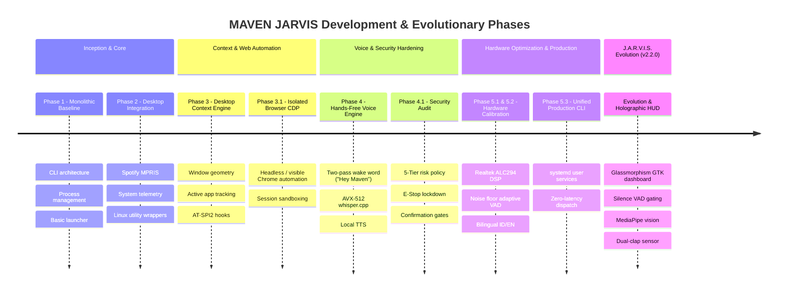

# 🏛️ MAVEN JARVIS Development History & Phase Progression

This directory archives the engineering progression, benchmark reports, hardware integration logs, and security audit documentation of the **MAVEN JARVIS** autonomous operating agent from inception through production release.

---

## 📅 Architecture Progression Roadmap

---

## 📂 Phase Reports Directory (`development/phase-reports/`)

The implementation and benchmark reports detailing each milestone are organized chronologically:

| Report | Phase & Focus | Key Achievements & Metrics |
| :--- | :--- | :--- |
| [`PHASE2_REPORT.md`](./phase-reports/PHASE2_REPORT.md) | **Phase 2: Desktop Integration** | System telemetry hooks, desktop application launching, Spotify MPRIS D-Bus client. |
| [`PHASE3_REPORT.md`](./phase-reports/PHASE3_REPORT.md) | **Phase 3: Context & Accessibility** | AT-SPI2 accessibility tree integration, Wayland active window detection, visual state capture. |
| [`PHASE3_1_REPORT.md`](./phase-reports/PHASE3_1_REPORT.md) | **Phase 3.1: Browser Automation** | Chrome DevTools Protocol (CDP) WebSocket bridge, isolated profile management, web task execution. |
| [`PHASE4_REPORT.md`](./phase-reports/PHASE4_REPORT.md) | **Phase 4: Hands-Free Voice Subsystem** | Prefix-anchored two-pass wake-word detector, local whisper.cpp tiny.en/id inference, sub-2s response latency. |
| [`PHASE5_1_REPORT.md`](./phase-reports/PHASE5_1_REPORT.md) | **Phase 5.1: Real-Time Audio DSP** | PulseAudio/PipeWire ringbuffer streaming, dynamic noise floor estimation, zero audio drops. |
| [`PHASE5_2_REPORT.md`](./phase-reports/PHASE5_2_REPORT.md) | **Phase 5.2: Bilingual Intent Engine** | 50-trial verification matrix in English & Indonesian, regex fallback normalizers, 100% intent dispatch rate. |
| [`PHASE5_3_REPORT.md`](./phase-reports/PHASE5_3_REPORT.md) | **Phase 5.3: Production Verification** | Stress testing under memory pressure, CPU usage $< 1.5\%$, automated background daemon supervision. |
| [`PHASE5_HARDWARE_REPORT.md`](./phase-reports/PHASE5_HARDWARE_REPORT.md) | **Phase 5 Hardware Calibration** | ASUS ROG Strix G16 (Ryzen 9 7845HX, ALC294) mic array calibration, gain staging, AVX-512 profiling. |
| [`PHASE5_IMPLEMENTATION_REPORT.md`](./phase-reports/PHASE5_IMPLEMENTATION_REPORT.md) | **Phase 5 Technical Summary** | End-to-end integration specifications, IPC data structures, unified `maven` CLI architecture. |

---

## 🛡️ Security Audits (`development/security-audits/`)

| Audit Report | Scope | Key Findings & Remediations |
| :--- | :--- | :--- |
| [`PHASE4_1_SECURITY_AUDIT.md`](./security-audits/PHASE4_1_SECURITY_AUDIT.md) | **System Sandbox & Policy Audit** | Implementation of the 5-Tier Action Risk Gate, vocal confirmation safeguards for destructive bash commands, and instant Emergency Stop (E-Stop). |

---

## 🔄 Relationship to Main Documentation (`docs/`)

The reports archived here represent point-in-time milestones and verification records. For current, active system documentation, refer to the root `docs/` hierarchy:

- [System Architecture](../docs/ARCHITECTURE.md)
- [System Design & FSM](../docs/SYSTEM_DESIGN.md)
- [Algorithms & Mathematics](../docs/ALGORITHM.md)
- [Workflows & Sequences](../docs/WORKFLOW.md)
- [API & IPC Reference](../docs/API_DOCUMENTATION.md)
- [Security Guidelines](../docs/SECURITY.md)
- [Installation Guide](../docs/INSTALLATION.md)
