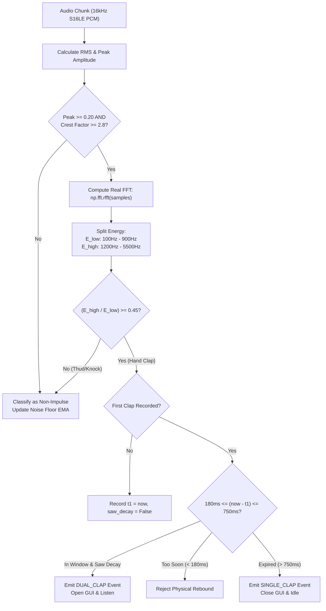
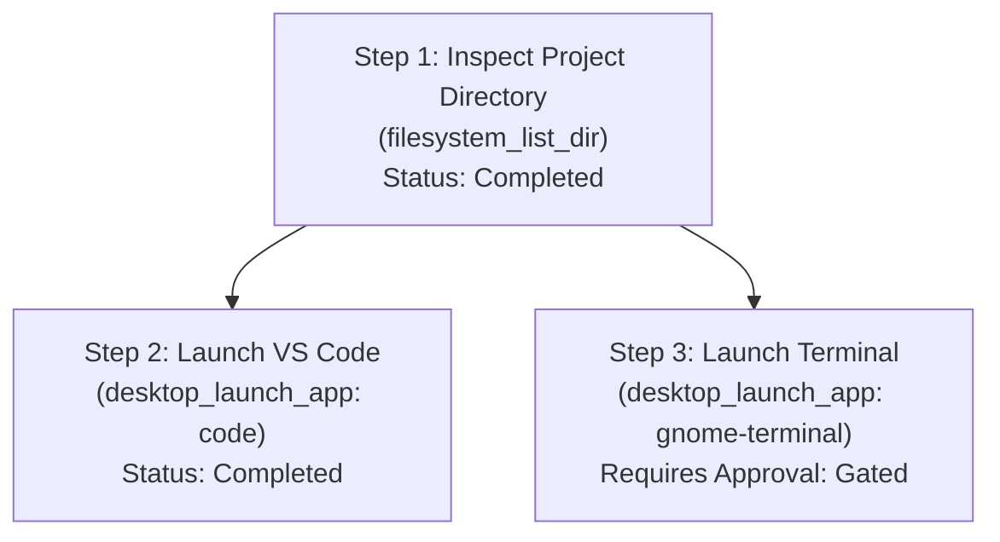
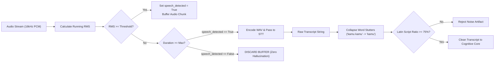

# MAVEN AI Agent — Core Algorithms & Mathematical Formulations

> **Technical Specifications:** Algorithmic walkthroughs, step-by-step logic, pseudocode, Big-O complexity analyses, data structures, and edge case handling across MAVEN subsystems.

---

## 1. Acoustic Dual-Clap & Spectral Discrimination Algorithm

### 1.1 Overview & Physical Principles
Acoustic clap detection enables non-verbal, hands-free hardware actuation (e.g. double-clap to open HUD and begin listening; single-clap to dismiss). The challenge in acoustic detection is rejecting non-clap impulsive sounds such as desk knocks, keyboard typing, door slams, coughing, and speech plosives.

MAVEN uses a dual-stage discriminator:
1. **Time-Domain Crest Factor Analysis:** Hand claps exhibit an extremely sharp transient peak compared to their Root Mean Square (RMS) energy.
2. **Frequency-Domain Spectral Energy Ratio (FFT):** Physical hand claps produce resonant snap frequencies primarily in the **1200 Hz – 5500 Hz** range. Conversely, desk thuds, table impacts, and keyboard taps resonate mechanically below **900 Hz**.



### 1.2 Mathematical Formulation

Given an audio frame $x = [x_0, x_1, \dots, x_{N-1}]$ where $N$ is the number of samples (typically 512 at 16 kHz):

$$\text{RMS}(x) = \sqrt{\frac{1}{N} \sum_{i=0}^{N-1} x_i^2}$$

$$\text{Peak}(x) = \max_{0 \le i < N} |x_i|$$

$$\text{Crest Factor } C(x) = \frac{\text{Peak}(x)}{\text{RMS}(x) + \epsilon}$$

The Fast Fourier Transform yields complex frequency components $X_k = \sum_{n=0}^{N-1} x_n e^{-j 2\pi k n / N}$. The energy in a frequency interval $[f_{\text{start}}, f_{\text{end}}]$ is:

$$E(f_{\text{start}}, f_{\text{end}}) = \sum_{k \in \text{band}} |X_k|^2$$

The spectral ratio test enforces:

$$\mathcal{R} = \frac{E(1200\text{ Hz}, 5500\text{ Hz})}{E(100\text{ Hz}, 900\text{ Hz}) + \epsilon} \ge 0.45$$

### 1.3 Pseudocode

```python
def process_clap_frame(frame_bytes, state):
    samples = decode_s16le_to_float32(frame_bytes)  # normalized [-1.0, 1.0]
    rms = sqrt(mean(samples ** 2))
    peak = max(abs(samples))
    crest = peak / (rms + 1e-5)

    # 1. Reject low amplitude and soft attacks
    if peak < 0.20 or crest < 2.8:
        state.update_noise_floor(rms)
        return ClapResult.NONE

    # 2. Reject sustained sounds without delta over noise floor
    if (rms - state.noise_floor) < max(0.04, state.noise_floor * 0.8):
        return ClapResult.NONE

    # 3. FFT Spectral Band Energy Ratio
    fft_mag = abs(rfft(samples))
    freqs = rfftfreq(len(samples), 1.0 / 16000.0)
    e_low = sum(fft_mag[(freqs >= 100) & (freqs < 900)] ** 2) + 1e-6
    e_high = sum(fft_mag[(freqs >= 1200) & (freqs <= 5500)] ** 2) + 1e-6

    if (e_high / e_low) < 0.45:
        # Table knock or keyboard tap: energy concentrated in bass
        return ClapResult.NONE

    now = current_time()
    if state.first_clap_time > 0:
        elapsed = now - state.first_clap_time
        if elapsed > 0.75: # Timed out waiting for 2nd clap
            state.reset()
            return ClapResult.SINGLE
        if elapsed >= 0.18 and state.saw_decay_between_claps:
            state.reset()
            return ClapResult.DUAL
    else:
        state.first_clap_time = now
        state.saw_decay_between_claps = False

    return ClapResult.NONE
```

### 1.4 Complexity Analysis
- **Time Complexity:** $\mathcal{O}(N \log N)$ where $N$ is chunk size ($N = 512$ samples). On modern x86_64, computing 512-point FFT via NumPy takes **$< 0.08$ milliseconds**.
- **Space Complexity:** $\mathcal{O}(N)$ for FFT buffer allocation (reused in-place, zero GC pressure).

---

## 2. DAG Task Planning & Topological Execution Algorithm

### 2.1 Overview & Data Structures
Multi-step user instructions (e.g. "siapkan environment dev untuk CampusLink") cannot be executed as monolithic linear scripts because individual steps have dependencies, differing risk tiers, and failure recovery policies.

MAVEN plans tasks as a **Directed Acyclic Graph (DAG)** $\mathcal{G} = (\mathcal{V}, \mathcal{E})$ where:
- $\mathcal{V}$ is the set of `TaskStep` nodes.
- $\mathcal{E}$ represents dependency edges $(u, v)$ indicating step $u$ must finish before step $v$ can execute.



### 2.2 DAG Validation & Topological Sort Algorithm (Kahn's Algorithm)

Before any plan is executed, it undergoes rigorous DAG cycle detection and topological sorting. If any cycle is detected, or if a step references an undefined dependency, the plan is rejected immediately.

```python
def validate_and_order_dag(steps: List[TaskStep]) -> List[TaskStep]:
    # 1. Verify Unique IDs and Non-Self Dependencies
    seen_ids = set()
    adj = {s.step_id: [] for s in steps}
    in_degree = {s.step_id: 0 for s in steps}

    for s in steps:
        if s.step_id in seen_ids:
            raise DuplicateStepError(s.step_id)
        seen_ids.add(s.step_id)

    for s in steps:
        for dep in s.dependencies:
            if dep == s.step_id:
                raise SelfDependencyError(s.step_id)
            if dep not in seen_ids:
                raise MissingDependencyError(dep)
            adj[dep].append(s.step_id)
            in_degree[s.step_id] += 1

    # 2. Kahn's Algorithm for Topological Sort
    queue = [sid for sid, deg in in_degree.items() if deg == 0]
    sorted_order = []

    while queue:
        u = queue.pop(0)
        sorted_order.append(u)
        for v in adj[u]:
            in_degree[v] -= 1
            if in_degree[v] == 0:
                queue.append(v)

    if len(sorted_order) != len(steps):
        raise CyclicDependencyError("Dependency cycle detected in plan graph.")

    step_map = {s.step_id: s for s in steps}
    return [step_map[sid] for sid in sorted_order]
```

### 2.3 Complexity Analysis
- **Time Complexity:** $\mathcal{O}(|\mathcal{V}| + |\mathcal{E}|)$ where $|\mathcal{V}|$ is the number of steps and $|\mathcal{E}|$ is the number of dependency constraints. For typical multi-step plans ($|\mathcal{V}| \le 10$), execution completes in **$< 0.05$ milliseconds**.
- **Space Complexity:** $\mathcal{O}(|\mathcal{V}| + |\mathcal{E}|)$ for in-degree hash maps and adjacency list structures.

---

## 3. Silence VAD Gating & Whisper Hallucination Filter

### 3.1 Problem Statement
Autoregressive encoder-decoder speech models like Whisper ggml-tiny tend to generate phantom text when fed low-energy ambient noise or room silence over sustained durations. Common hallucinations include repetitive word loops ("kamu kamu memomong..."), YouTube subtitle credits ("Thank you for watching"), or random phonemic bursts ("BELENCIS!").

### 3.2 Solution Architecture
MAVEN implements a two-stage filter:
1. **Pre-STT Acoustic Energy Gate (`VoiceSession`):** If recording reaches the maximum boundary ($T_{\text{max}} = 6.0\text{s}$) and no frame ever exceeded the speech onset threshold ($\text{RMS} \ge \text{Floor} + 0.035$), the entire buffer is dropped without invoking Whisper.
2. **Post-STT Lexical & Stutter Filter (`WhisperCppSTTProvider`):** Transcripts undergo regex normalization to collapse stutter loops ($\text{Regex: } \backslash b(\backslash w+)(?:\backslash s+\backslash 1\backslash b)+ \to \backslash 1$) and match against the blocklist.



---

## 4. 21-Landmark Hand Gesture Kinematics Algorithm

### 4.1 Coordinate Normalization & Smoothing
MediaPipe returns 21 normalized 3D hand landmarks:

$$P_i = (x_i, y_i, z_i), \quad i \in [0, 20], \quad x_i, y_i \in [0.0, 1.0]$$

To eliminate jitter caused by webcam sensor noise, landmark positions pass through an Exponential Moving Average (EMA) filter before being mapped to screen coordinates:

$$\hat{P}_i^{(t)} = \alpha P_i^{(t)} + (1 - \alpha) \hat{P}_i^{(t-1)}, \quad \alpha = 0.65$$

### 4.2 Pinch Gesture Metric for Virtual Clicking
The index finger tip ($P_8$) and thumb tip ($P_4$) Euclidean distance governs mouse clicking:

$$d_{\text{pinch}} = \|P_8 - P_4\|_2 = \sqrt{(x_8 - x_4)^2 + (y_8 - y_4)^2 + (z_8 - z_4)^2}$$

- **Click Threshold:** If $d_{\text{pinch}} < 0.045$, a `LEFT_DOWN` virtual mouse event is triggered.
- **Release Threshold (Hysteresis):** If $d_{\text{pinch}} > 0.070$, a `LEFT_UP` event is triggered.
- *Hysteresis prevents rapid click oscillation when the user's hand hovers near the boundary.*
