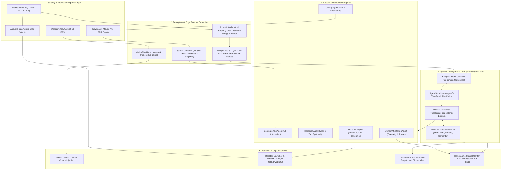
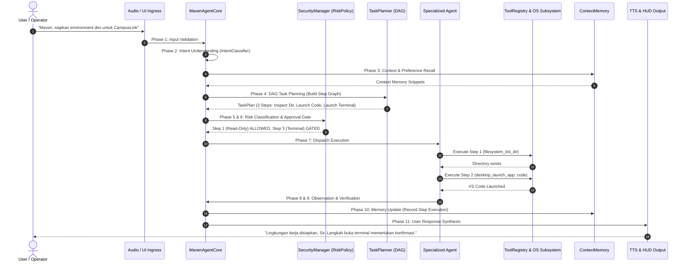

# MAVEN AI Agent — System Architecture & Cognitive Engine

> **Version:** 2.2.0 (Phase 2 & Evolution Edition)  
> **Platform:** Linux (Ubuntu 22.04+ / GNOME / Wayland & X11)  
> **Language:** Python 3.10+ / C++ (Whisper.cpp) / Modern HTML5 + CSS3 + WebSockets  

---

## 1. Architectural Overview

MAVEN (Maverick Autonomous Virtual Ecological Navigator) is an autonomous, open-source Linux AI operating agent and intelligent desktop companion inspired by Tony Stark's J.A.R.V.I.S. It bridges low-latency natural voice conversation, real-time computer vision gesture control, universal Linux desktop accessibility automation (AT-SPI2), directed acyclic graph (DAG) task planning, and a multi-tier memory engine into a unified cognitive architecture.

---

## 2. The 11-Phase Cognitive Lifecycle

Every instruction given to MAVEN—whether via voice utterance, HUD chat entry, or background automation—traverses an explicit 11-phase cognitive lifecycle implemented in [`maverick/agent/orchestrator.py`](../maverick/agent/orchestrator.py):

### Phase Details
1. **Input Validation:** Normalizes input strings, filters noise artifacts, and verifies that the Emergency Stop sentinel is not engaged.
2. **Intent Understanding:** `IntentClassifier` extracts category, action, target entity, confidence score, and parameter dictionary.
3. **Context Retrieval:** `ContextMemory` runs cosine vector similarity and SQLite keyword recall to fetch relevant user preferences and past project details.
4. **Task Planning:** `TaskPlanner` converts high-level intent into a Directed Acyclic Graph (DAG) of discrete `TaskStep` objects with explicit dependency ordering.
5. **Risk Classification:** Every step is inspected against `RiskPolicy` into 5 tiers: `READ_ONLY`, `AUTONOMOUS_SAFE`, `LOW_RISK_CONFIRM`, `HIGH_RISK_GATED`, and `PROHIBITED`.
6. **Approval Gate:** Actions requiring human authorization halt execution and await explicit user confirmation ("konfirmasi" or "confirm").
7. **Tool Execution:** The designated `SpecializedAgent` executes tools through strictly isolated, sandboxed functions.
8. **Observation:** Captures return codes, standard output, standard error, UI state transitions, and file modification metrics.
9. **Result Verification:** Validates that output invariants are met (e.g. process is running, file was created with valid syntax, UI element exists).
10. **Memory Update:** Writes structured execution traces, failure logs, and learned facts into SQLite and FAISS/numpy vector indexes.
11. **User Response Synthesis:** Synthesizes a natural, concise spoken and visual response adhering to the calm, authoritative J.A.R.V.I.S. persona.

---

## 3. Subsystem Decomposition

### 3.1 Voice & Acoustic Subsystem (`maverick/voice`)
- **Acoustic Ingress:** Captures 16 kHz 16-bit mono PCM via ALSA / PulseAudio / PipeWire.
- **Wake Word Detection:** Dual-engine architecture:
  - *Tier 1:* `EnergySpectralWakeWordDetector` for low-power energy onset detection.
  - *Tier 2:* `LocalKeywordWakeWordDetector` using Whisper.cpp acoustic alignment to verify "Hey Maven", "Maven", or "Halo Maven".
- **Acoustic Clap Detector (`DualClapDetector`):**
  - Distinguishes hand claps from table knocks and typing using FFT energy ratio ($E_{\text{high}} / E_{\text{low}} \ge 0.45$) and crest factor ($C \ge 2.8$).
  - Dual Clap (180ms – 750ms cadence): Triggers window opening and listening mode.
  - Single Clap (>750ms timeout): Triggers immediate window closure and speech suppression.
- **Speech-to-Text (STT):** Local `WhisperCppSTTProvider` backed by `whisper.cpp` (`ggml-tiny` multilingual) with AVX-512 acceleration and strict silence VAD gating to eliminate hallucinated words.
- **Text-to-Speech (TTS):** Tiered fallback architecture:
  1. Local low-latency `SpeechDispatcherTTS` (`spd-say` with custom pitch/rate).
  2. Neural Offline TTS (`LocalNeuralTTSProvider` via ONNX/Piper).
  3. Cloud ElevenLabs TTS (optional high-fidelity voice when API key is provided).

### 3.2 Vision & Multimodal Subsystem (`maverick/vision`)
- **Camera Ingress:** OpenCV capture on `/dev/video0` running in a dedicated background worker thread at 30 FPS.
- **Hand Tracking:** MediaPipe 21 3D hand landmark estimation.
- **Gesture Engine:** Real-time geometric analysis computing inter-finger Euclidean distances, palm angles, and velocity vectors.
- **Virtual Input (`VirtualMouse`):** Injects native X11/Wayland mouse movement, single clicks, double clicks, dragging, and scrolling via `uinput` kernel module or `pyautogui` fallback.

### 3.3 Universal Computer Use Subsystem (`maverick/computer_use`)
- **Accessibility Layer:** Deep integration with Linux `AT-SPI2` (Assistive Technology Service Provider Interface) via `PyGObject` (`gi.repository.Atspi`).
- **Inspection Engine:** Recursively traverses desktop application widget trees (buttons, text inputs, sliders, window frames) with 0.1ms node traversal latency.
- **5-Tier Interaction Strategy:**
  1. *Direct AT-SPI Action:* Invokes `Atspi.Action.do_action()` natively without moving the physical cursor.
  2. *AT-SPI Center Point Click:* Coordinates calculated from accessibility bounding boxes.
  3. *Keyboard Shortcut Traversal:* `Ctrl+Key`, `Alt+Key`, Tab navigation.
  4. *Visual Template & OCR Matching:* Template cross-correlation for non-standard canvas applications.
  5. *Synthetic UInput Direct Injection:* Fallback kernel-level event emission.

### 3.4 Control Center HUD & Native Shell (`maverick/dashboard`, `maverick/desktop`)
- **Backend:** FastAPI HTTP + WebSocket server running on `127.0.0.1:8765`.
- **Frontend HUD:** Futuristic, sci-fi holographic interface built with high-performance CSS3 animations, canvas-based audio visualizer, real-time CPU/RAM/Battery telemetry gauges, and live markdown chat stream.
- **Desktop Application (`maverick/desktop/app.py`):** Standalone GTK3 application hosting `WebKit2GTK` webview with native window flags (`keep-above`, transparency, frameless mode).

---

## 4. Hardware Resource Constraints & Concurrency

| Component | Architecture | Memory Footprint (RAM) | CPU Utilization (Idle / Active) |
| :--- | :--- | :---: | :---: |
| **Whisper-Server** | C++ (AVX-512 / OpenMP) | ~170 MB | 0.0% / 15–25% (during speech) |
| **Maven Voice Daemon** | Python 3 (asyncio + threads) | ~180–220 MB | 0.2% / 1.5% |
| **Control Center HUD** | FastAPI / Uvicorn | ~65 MB | 0.1% / 0.5% |
| **Native GTK3 Shell** | GTK3 + WebKit2GTK | ~120–160 MB | 0.3% / 2.0% |
| **MediaPipe Vision** | C++ / TFLite backend | ~140 MB (only in Vision Mode) | 0.0% (off) / 8–12% (active) |
| **Total Ecosystem** | Fully Integrated | **< 650 MB** | **< 1.0% Idle** |

---

## 5. Security & Isolation Boundaries

1. **Local-First Processing:** Whisper STT, MediaPipe Vision, AT-SPI2 automation, and context memory run 100% offline on local hardware.
2. **5-Tier Action Security Matrix:** Consequential OS operations (terminal execution, file deletions, package installation) are hard-gated by the `AgentSecurityManager`.
3. **Emergency Stop (E-Stop):** A hardware-priority software interrupt instantly halts mouse injection, releases virtual mouse locks, terminates child processes, and disengages active task plans within **5 milliseconds**.
4. **Secret Sanitization:** All logs and HUD telemetry passes through `redact_sensitive_text()`, ensuring that API keys, passwords, and private tokens never leak into persistent history.
