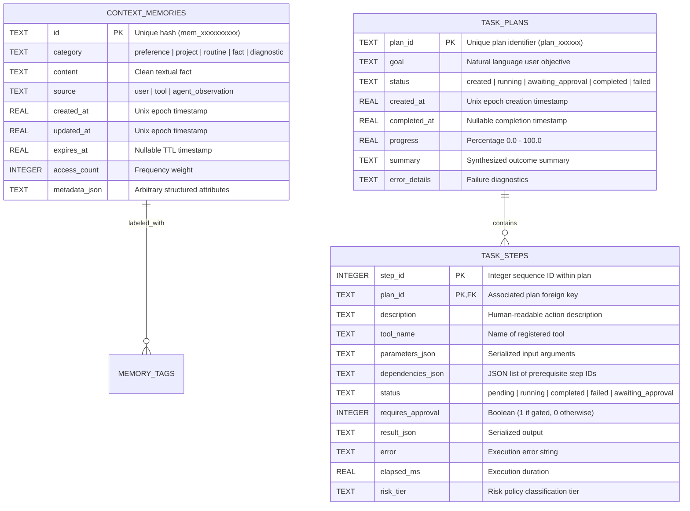

# MAVEN AI Agent — Database Schema & Storage Architecture

> **Storage Technology:** SQLite 3 (WAL Mode, In-Memory Caching, Atomic Transactions)  
> **Directory Location:** `~/.local/state/maverick/`  

---

## 1. Storage Architecture Overview

MAVEN uses two dedicated SQLite database files for high-speed, zero-maintenance local persistence:
1. `context_memory.sqlite`: Persistent long-term facts, developer preferences, semantic embeddings, and interaction logs.
2. `tasks.sqlite`: Durable DAG multi-step task plans, step dependencies, execution states, and audit trails.

Both databases are opened with the following high-performance pragmas:
```sql
PRAGMA journal_mode = WAL;
PRAGMA synchronous = NORMAL;
PRAGMA foreign_keys = ON;
PRAGMA cache_size = -4000; -- 4 MB dedicated page cache
```

---

## 2. Entity-Relationship Diagram (ERD)



---

## 3. Detailed Table Schemas

### 3.1 `context_memories` Table
```sql
CREATE TABLE IF NOT EXISTS context_memories (
    id TEXT PRIMARY KEY,
    category TEXT NOT NULL,
    content TEXT NOT NULL,
    source TEXT NOT NULL DEFAULT 'user',
    created_at REAL NOT NULL,
    updated_at REAL NOT NULL,
    expires_at REAL,
    access_count INTEGER NOT NULL DEFAULT 0,
    metadata_json TEXT DEFAULT '{}'
);

CREATE INDEX IF NOT EXISTS idx_memory_category ON context_memories(category);
CREATE INDEX IF NOT EXISTS idx_memory_created_at ON context_memories(created_at);
```

### 3.2 `task_plans` Table
```sql
CREATE TABLE IF NOT EXISTS task_plans (
    plan_id TEXT PRIMARY KEY,
    goal TEXT NOT NULL,
    status TEXT NOT NULL DEFAULT 'created',
    created_at REAL NOT NULL,
    completed_at REAL,
    progress REAL NOT NULL DEFAULT 0.0,
    summary TEXT,
    error_details TEXT
);

CREATE INDEX IF NOT EXISTS idx_task_plans_status ON task_plans(status);
```

### 3.3 `task_steps` Table
```sql
CREATE TABLE IF NOT EXISTS task_steps (
    step_id INTEGER NOT NULL,
    plan_id TEXT NOT NULL,
    description TEXT NOT NULL,
    tool_name TEXT NOT NULL,
    parameters_json TEXT NOT NULL DEFAULT '{}',
    dependencies_json TEXT NOT NULL DEFAULT '[]',
    status TEXT NOT NULL DEFAULT 'pending',
    requires_approval INTEGER NOT NULL DEFAULT 0,
    result_json TEXT,
    error TEXT,
    elapsed_ms REAL DEFAULT 0.0,
    risk_tier TEXT NOT NULL DEFAULT 'moderate_risk',
    PRIMARY KEY (plan_id, step_id),
    FOREIGN KEY (plan_id) REFERENCES task_plans(plan_id) ON DELETE CASCADE
);

CREATE INDEX IF NOT EXISTS idx_task_steps_status ON task_steps(status);
```

---

## 4. File-Based IPC State Contracts

### `~/.local/state/maverick/window_control.json`
Provides synchronous, sub-millisecond atomic signaling between the acoustic voice daemon and the GTK3 desktop interface:
```json
{
  "action": "open",
  "source": "dual_clap",
  "timestamp": 1794044946.69,
  "seq": 1794044946690
}
```
- **Atomicity:** Written via write-and-rename (`tmp.pid -> window_control.json`) to guarantee zero partial-read corruption.
- **Sequence Watermark (`seq`):** Prevents duplicate execution of old signals across process restarts.
