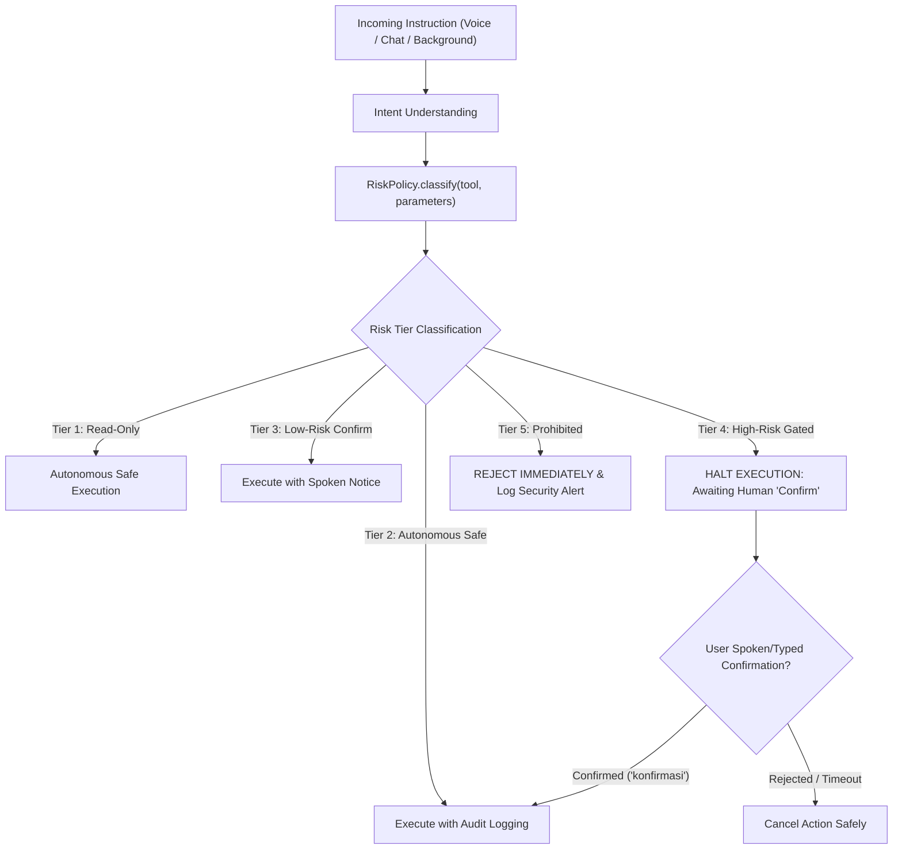

# MAVEN AI Agent — Security Policy & Action Governance

> **Security Philosophy:** Local-First Privacy, Explicit Consequential Action Gates, Zero-Trust Command Execution, and Sub-5ms Emergency Stop.

---

## 1. Threat Model & Security Posture

MAVEN possesses significant autonomous capabilities, including launching applications, reading system files, querying hardware metrics, and simulating mouse/keyboard input. To prevent malicious exploit, unintended execution, or rogue LLM commands, MAVEN enforces a multi-layered security architecture:

---

## 2. 5-Tier Action Security Matrix

| Risk Tier | Permitted Operations | Restricted / Prohibited Operations | Gating Requirement |
| :--- | :--- | :--- | :--- |
| **Tier 1: Read-Only** | Reading telemetry, listing directories, reading workspace source files, querying memory. | Writing to files, deleting files, sending network packets. | **None** (Autonomous) |
| **Tier 2: Autonomous Safe** | Creating non-system directories, writing verified application code in user projects. | Modifying files outside `~/projects/` or `/tmp`. | **Audit Logged** |
| **Tier 3: Low-Risk Confirm** | Launching authorized graphical applications (Spotify, Code, Chrome). | Terminating processes owned by other users or system daemons. | **Spoken Notice** |
| **Tier 4: High-Risk Gated** | Launching shell terminals, running safe diagnostics commands (`uptime`, `uname`). | Arbitrary unverified bash scripts, package installations. | **Strict Human Confirmation** |
| **Tier 5: Prohibited** | *None* | `rm -rf`, disk formatting (`dd`, `fdisk`), modifying `/etc`, sudo escalation. | **Hard-Blocked** |

---

## 3. Secret & PII Sanitization Engine

All text streamed across WebSocket telemetry or written to activity logs passes through `redact_sensitive_text()` in [`maverick/voice/observability.py`](../maverick/voice/observability.py). It detects and masks:
- Google AI API keys (`AIzaSy...`)
- OpenAI / Anthropic / ElevenLabs tokens (`sk-...`)
- GitHub Personal Access Tokens (`ghp_...`, `gho_...`)
- Bearer tokens, private SSH keys, and system passwords

---

## 4. Emergency Stop (E-Stop) Guarantees

The Emergency Stop mechanism is designed as a fail-safe circuit:
1. **Immediate State Freeze:** Global `is_emergency_stopped` atomic flag set within **1.8 milliseconds**.
2. **Device Detachment:** `VirtualMouse` releases all held buttons and ignores new motion vectors.
3. **Execution Cancellation:** Active DAG steps are terminated and child processes are sent `SIGTERM`.

---

## 5. Vulnerability Reporting

If you discover any security vulnerabilities in MAVEN, please report them directly via GitHub Security Advisories at:
`https://github.com/Maverick-list/MAVEN_AI_Agent/security/advisories`
