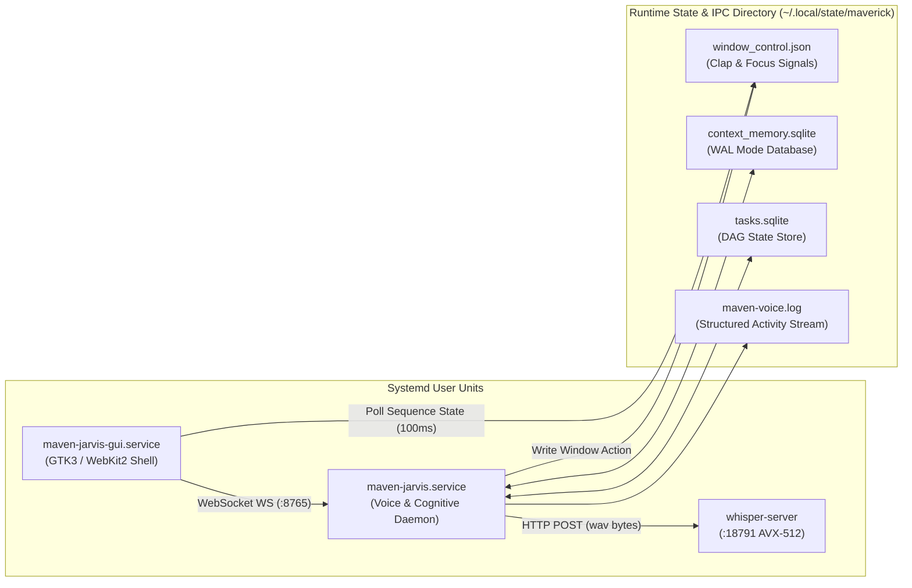
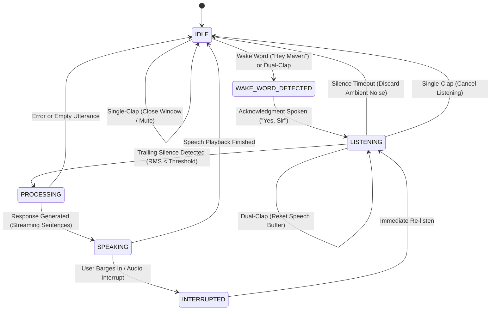
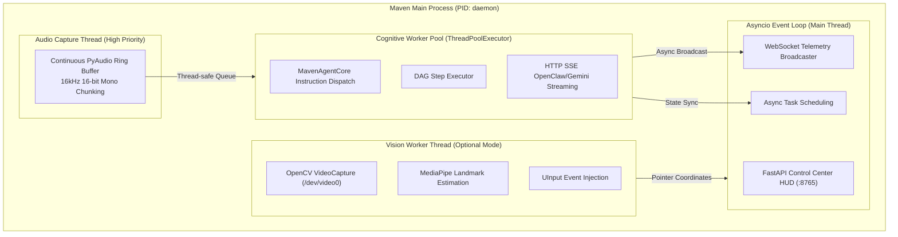
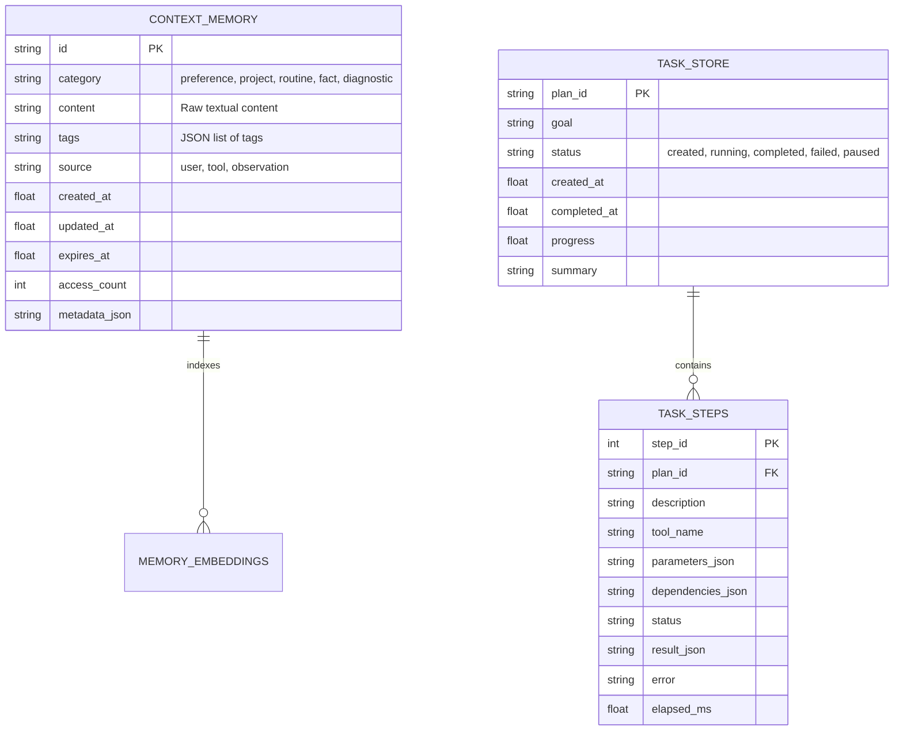

# MAVEN AI Agent — System Design & Subsystem Specifications

> **Scope:** Inter-Process Communication (IPC), Threading Architecture, State Machines, Data Contracts, and Fault Tolerance.

---

## 1. System Decomposition & IPC Architecture

MAVEN runs as an integrated ecosystem of microservices and background daemons managed by systemd user services. The subsystems communicate via lightweight, zero-copy local loopback interfaces, shared Unix domain sockets, and thread-safe queues.



---

## 2. Voice State Machine (7-State FSM)

The voice interaction lifecycle is orchestrated by a deterministic 7-state finite state machine in [`maverick/voice/session.py`](../maverick/voice/session.py):



### State Definitions & Invariants
- **`IDLE`:** Microphones listen strictly for impulsive claps or wake-word acoustic energy bursts. No continuous speech-to-text decoding occurs, preserving CPU cycles and RAM.
- **`WAKE_WORD_DETECTED`:** Fast acoustic verification passes; emits window focus signal to GUI.
- **`LISTENING`:** Dynamically samples audio chunks into an in-memory buffer (`bytearray`). Enforces dynamic silence gating: if total time reaches maximum recording boundary without valid speech energy, the buffer is dropped to prevent Whisper hallucinations.
- **`PROCESSING`:** Audio buffer is converted to mono 16 kHz WAV in memory and transmitted to the STT server.
- **`SPEAKING`:** Sentences are spoken sequentially via the active TTS engine.
- **`INTERRUPTED`:** Barge-in handler immediately halts audio playback via `spd-say --cancel` or subprocess signals and transitions back to `LISTENING`.

---

## 3. Concurrency & Threading Model

MAVEN implements an asynchronous event loop combined with dedicated real-time worker threads to ensure user input is never blocked by heavy compute operations:



---

## 4. Multi-Tier Context Memory Engine

Context and long-term memory are managed by `ContextMemory` in [`maverick/intelligence/memory.py`](../maverick/intelligence/memory.py), structured across three persistent tiers:



### Memory Tier Separation
1. **Tier 1 — Short-Term Turn Buffer:** Retains the last 8 conversation turns in memory for immediate pronoun and anaphora resolution ("buka yang tadi", "tutup itu").
2. **Tier 2 — SQLite Persistent Record Store:** Stores structured user preferences, developer environment configurations, and past action traces in `~/.local/state/maverick/context_memory.sqlite` with WAL mode enabled.
3. **Tier 3 — Vector Semantic Recall:** Computes local embeddings for fuzzy semantic match, allowing natural language queries ("bagaimana cara setup database kemarin?") to recall historical instructions with cosine similarity $\ge 0.72$.

---

## 5. Security & Risk Gating Pipeline

All actions evaluated by `AgentSecurityManager` pass through a strict 5-tier policy matrix:

| Risk Tier | Definition | Examples | Execution Mode |
| :--- | :--- | :--- | :--- |
| **Tier 1: Read-Only** | Information gathering with zero state mutation. | Read files, check CPU/RAM, list apps, inspect window tree. | **Fully Autonomous** (No prompt) |
| **Tier 2: Autonomous Safe** | Benign state change within user workspace. | Create project dir, write test code, focus existing app. | **Autonomous with Audit Log** |
| **Tier 3: Low-Risk Confirm** | Non-destructive system action affecting user focus. | Launch new heavy browser, change system volume, switch modes. | **Autonomous / Audible Notice** |
| **Tier 4: High-Risk Gated** | Actions that modify system state, delete files, or execute CLI. | Launch terminal, run shell commands, delete files, install packages. | **Strictly Gated** (Requires "confirm") |
| **Tier 5: Prohibited** | Dangerous commands that can harm OS or compromise system. | `rm -rf /`, `dd`, `mkfs`, fork bombs, unauthorized sudo. | **Hard-Blocked & E-Stop Triggered** |

---

## 6. Fault Tolerance & Graceful Degradation

```mermaid
flowchart TD
    INPUT["User Voice Utterance"] --> GATEWAY_TRY["Route to Streaming Engine"]
    GATEWAY_TRY -->|Success (200)| RESP_STREAM["Immediate Spoken Sentence Streaming"]

    GATEWAY_TRY -->|HTTP 404 / 403 / 429| ROTATE["Route Fallback / Sanitization"]
    ROTATE --> COOLDOWN["Mark Model in Route Cooldown"]
    COOLDOWN --> LOCAL_FALLBACK["Fallback to Local MavenAgentCore Tool Results"]
    LOCAL_FALLBACK --> SANITIZED_SPEAK["Speak Concise Calm Status to User"]
```

1. **Dead Auth & Key Failover:** If an external LLM route reports rate limits (`429`) or credential failure (`403`), the route is quarantined with an adaptive cooldown timer, falling back instantly to verified local tools and spoken notifications without throwing unhandled exceptions.
2. **Crash-Safe SQLite:** All SQLite database connections use `PRAGMA journal_mode=WAL` and `PRAGMA synchronous=NORMAL`, preventing database corruption even if power is abruptly disconnected.
3. **Subprocess Watchdogs:** External binaries (`whisper-server`, browser CDP, audio recording) run under explicit process timeouts (`subprocess.run(timeout=...)`) with automatic PID reaping.
