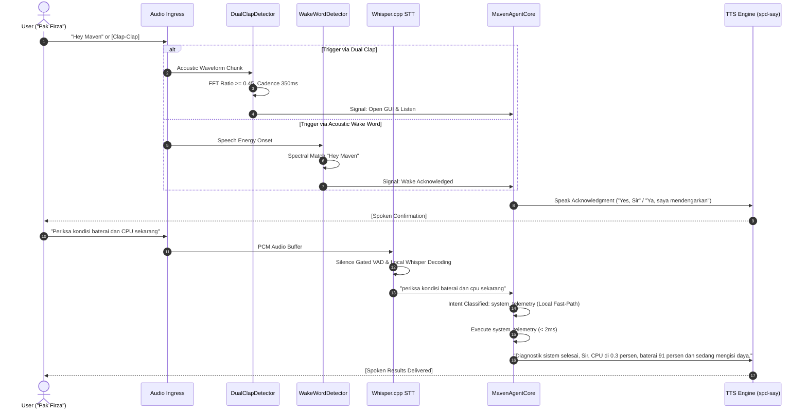
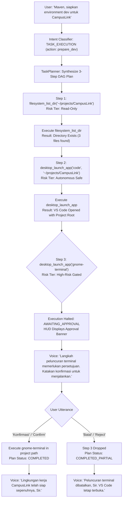
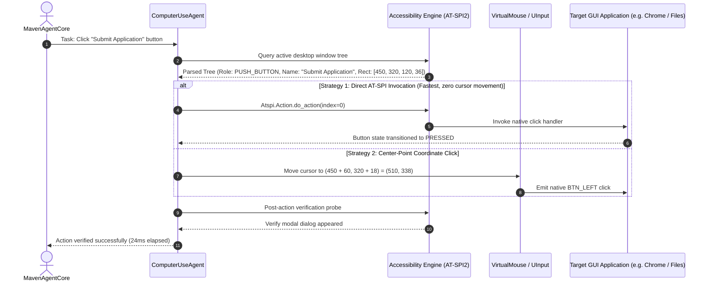
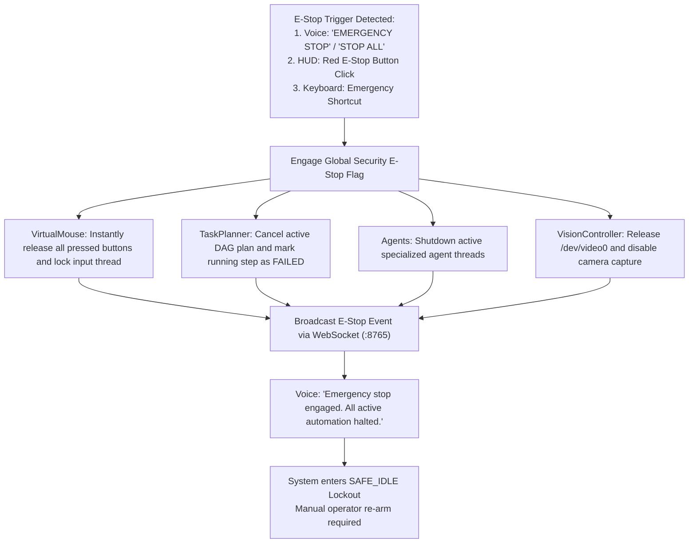

# MAVEN AI Agent — Operational Workflows & Interaction Scenarios

> **Guide to Core Operational Workflows:** Step-by-step procedures for voice interaction, desktop automation, safety approvals, multimodal vision gestures, and emergency stops.

---

## 1. End-to-End Voice Interaction Workflow

---

## 2. Autonomous Developer Workspace Preparation Workflow

This workflow orchestrates multi-step developer environment setup (e.g., inspecting project folders, launching VS Code, and gating terminal launch):

---

## 3. Universal Computer Use & AT-SPI2 Accessibility Workflow

When interacting with arbitrary Linux desktop graphical applications:

---

## 4. Hardware Safety & Emergency Stop (E-Stop) Workflow

All E-Stop trigger paths execute synchronously within **$< 5$ milliseconds**, ensuring physical safety and preventing errant cursor or terminal actions.
