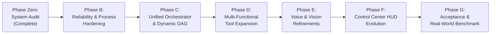

# Maven JARVIS — Evolution Roadmap
**Strategic Evolutionary Architecture for the Ultimate AI Operating Assistant**
*Document Version: 1.0.0 | Date: October 31, 2026 | Environment: Ubuntu 26.04.1 LTS (Wayland)*

---

## 1. Executive Vision

The objective of the **Maven JARVIS Evolution** is to transform Maven from a collection of loosely coupled desktop automation scripts and voice handlers into an integrated, autonomous, multi-modal **Personal AI Operating Assistant** on Ubuntu GNOME Wayland.

Maven will not merely respond to discrete commands; it will reason about high-level user intent, observe the desktop environment, autonomously synthesize multi-step directed acyclic graphs (DAGs), coordinate tools with formal safety boundaries, verify execution outcomes, and maintain continuity across multi-turn workflows.

---

## 2. Guiding Principles & Active Trial Protection

1. **Strict 7-Day Usage Trial Safeguard:** The active 7-Day Usage Trial is continuously executing in the workspace. All architectural evolutions must be developed, tested, and staged in an isolated development environment/worktree (`feature/jarvis-evolution`). The baseline trial logs (`reports/7-day-trial/`) and monitoring daemon (PID 20667) must remain undisturbed.
2. **Empirical Verification Over Simulation:** No capability is marked complete or verified without automated test execution, hardware validation, and verifiable system artifacts.
3. **Wayland & Linux Native Confinement:** Retain unprivileged user-space operation via GNOME AT-SPI, avoiding invasive kernel modules or root daemons.
4. **Multi-Tier Security & Reversibility:** Every mutating action must pass risk-tier evaluation (`NORMAL`, `SENSITIVE`, `CRITICAL`), enforce human-in-the-loop confirmation for critical operations, and offer rollback mechanisms.

---

## 3. Phased Evolution Roadmap

---

### Phase Zero — Complete System Audit (COMPLETED)
- **Status:** **DELIVERED**
- **Milestones:**
  1. Complete system architecture and process tree mapping (`system_architecture_audit.md`).
  2. Subsystem capability classification across 44 core features (`subsystem_capability_matrix.md`).
  3. Codebase technical debt and anti-pattern discovery (`technical_debt_report.md`).
  4. Failure modes, single points of failure, and recovery mechanics (`reliability_risk_report.md`).
  5. Security audit identifying path traversal vulnerability in write tools (`security_review.md`).
  6. Empirical CPU, RAM, GPU, and process resource utilization audit (`resource_usage_audit.md`).
  7. OS interfaces, AT-SPI, IPC sockets, and D-Bus integration mapping (`integration_dependency_map.md`).

---

### Phase B — Reliability & Lifecycle Hardening
- **Objective:** Eliminate runtime vulnerabilities, patch path traversal, harden subprocess execution, and implement robust crash recovery.
- **Key Deliverables:**
  1. **Security Patch:** Enforce canonical `os.path.realpath()` validation in all filesystem creation and write tools in `maverick/intelligence/tools.py`.
  2. **Auto-Release Input Watchdog:** Implement hardware watchdog in `VirtualInput` ensuring virtual mouse buttons auto-release on physical input or 3.0s timeout.
  3. **Process Registry & Orphan Reaper:** Implement `ProcessTracker` to record, monitor, and gracefully terminate spawned subprocesses.
  4. **Dynamic Dependency Prober:** Create `DependencyVerifier` to detect available system binaries (`code`, `google-chrome`, `libreoffice`, `tesseract`) before tool invocation.

---

### Phase C — Unified Orchestrator & Dynamic DAG Planning
- **Objective:** Replace brittle regex pattern matching with a generative LLM-assisted DAG planner supporting full state machine transitions and persistence.
- **Key Deliverables:**
  1. **Formal Task State Machine:** Expand `TaskStatus` to include `CREATED` $\rightarrow$ `UNDERSTANDING` $\rightarrow$ `PLANNING` $\rightarrow$ `AWAITING_APPROVAL` $\rightarrow$ `EXECUTING` $\rightarrow$ `VERIFYING` $\rightarrow$ `RECOVERING` $\rightarrow$ `COMPLETED`.
  2. **LLM-Assisted DAG Planner:** Synthesize ordered steps with dynamic dependencies, verification criteria, and parameter validation.
  3. **Persistent SQLite Plan Storage:** Implement WAL-backed task checkpointing in `~/.maverick/tasks.db` supporting pause/resume across sessions.
  4. **Outcome Verification Engine:** Introduce explicit post-condition verifiers (file existence, process status, visual element check) after step completion.

---

### Phase D — Multi-Functional Tool Expansion
- **Objective:** Expand Maven's toolkit beyond raw shell execution into high-level, domain-specific modules.
- **Key Deliverables:**
  1. **Codebase Exploration Tool:** Python AST parsing, symbol grep, definition navigation, and semantic code search.
  2. **Document & Report Generation Tool:** Pure-Python generators for `.docx` (`python-docx`), `.pdf` (`reportlab`/`pypdf`), `.xlsx` (`openpyxl`), and Markdown.
  3. **Structured Web Research Tool:** Search query decomposition, headless extraction, content deduplication, and fact synthesis.
  4. **Consolidated Tool Registry:** Unify tool definitions, input schemas, and risk tiers into a single modular package.

---

### Phase E — Conversational & Voice Refinements
- **Objective:** Enhance natural voice conversation flow, barge-in response, and contextual memory.
- **Key Deliverables:**
  1. **Barge-in Interruption:** Immediate TTS audio suppression upon detected user speech.
  2. **Bilingual Natural Language Normalization:** Seamless Indonesian-English mixed phrasing understanding.
  3. **Multi-Turn Semantic Memory:** Long-term context retrieval with topic tagging and automatic project preference synthesis.

---

### Phase F — Native Desktop UI & HUD Evolution
- **Objective:** Evolve Control Center into a modern operating dashboard with live DAG visualization and active task controls.
- **Key Deliverables:**
  1. **Interactive DAG Visualizer:** Render active task steps, dependencies, real-time status badges, and elapsed milliseconds.
  2. **Human Approval Modal:** Inline UI prompt displaying step description, tool risk, parameters, and one-click "Approve" / "Reject" controls.
  3. **Enhanced Telemetry Gauges:** Real-time CPU, RAM, battery, active window, and interaction mode indicators.

---

### Phase G — Comprehensive Acceptance & Real-World Benchmark
- **Objective:** Validate end-to-end performance against real Linux desktop applications and produce final acceptance deliverables.
- **Key Deliverables:**
  1. Full regression test suite run (ensure $\ge 295$ tests pass).
  2. Multi-step real application benchmark: VS Code development, Document synthesis, Web research, and Desktop navigation.
  3. Comprehensive documentation: `implementation_log.md`, `test_results.md`, `real_world_benchmark.md`, `rollback_guide.md`, and `final_acceptance_report.md`.
