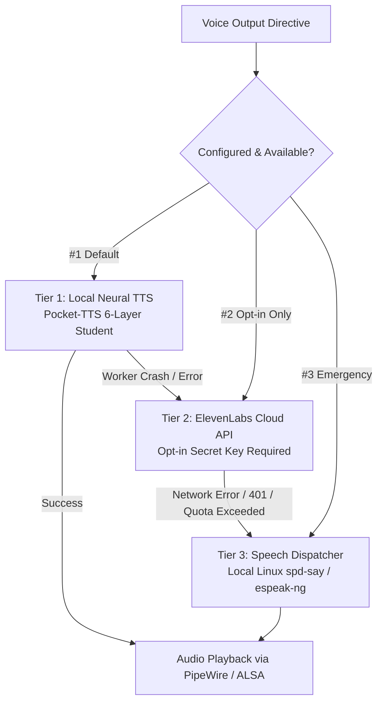

# MAVEN JARVIS — PERMANENT NATURAL VOICE ARCHITECTURE
**Component:** Voice Synthesizer Subsystem  
**Default Mode:** Offline Neural TTS (`local_neural`)  
**Primary Voice:** `george` (Natural British Male, JARVIS tone)  
**Secondary Voice:** `jean` (Clear American Male)  
**Offline Environment:** `HF_HUB_OFFLINE=1`  

---

## 1. Architectural Overview & Priority Cascade
Maven JARVIS operates with a 3-tier synthesis hierarchy designed for absolute availability, natural human prosody, zero cloud costs, and zero external network dependence:

### Hierarchy Breakdown:
1. **Tier 1 (Default): Local Neural TTS (`PocketTTSEngine`)**
   - Runs locally in Python 3.12/3.14 via an isolated warm persistent worker thread.
   - Loads model weights once into host RAM (~550MB resident footprint).
   - Operates strictly offline (`HF_HUB_OFFLINE=1`).
   - Zero paid cloud credits or internet access required.
2. **Tier 2 (Opt-in Cloud): ElevenLabs Streaming API**
   - Strictly secondary and requires active explicit opt-in in `~/.config/maverick/voice_settings.json`.
   - Used only when the user explicitly configures an API key and selects ElevenLabs.
3. **Tier 3 (Emergency Fallback): Linux Speech Dispatcher**
   - Invokes local `spd-say` or `espeak-ng`.
   - Guaranteed to work on barebones Linux even if Python neural environments are uninitialized.

---

## 2. Neural Model Specifications & Offline Storage
The local neural voice engine utilizes the Pocket-TTS English 6-layer architecture:

| Property | Value |
|---|---|
| **Architecture** | Lightweight Flow Matching / Conformer TTS |
| **Model Size** | 208.88 MB (`model.safetensors`) |
| **Tokenizer** | SentencePiece 50,000 vocab (`tokenizer.model`) |
| **Sample Rate** | 24,000 Hz (24kHz Mono 16-bit PCM) |
| **Quantization** | FP32 / BF16 CPU optimized |
| **Cached Location** | `~/.local/share/maverick/models/tts/pocket-tts-english/` |
| **Voices Available** | `george` (Male JARVIS), `jean` (Warm Male), `charles` (Refined Male), `stuart_bell` (Clear Male), `marius` (Articulate Male), `javert` (Authoritative Male), `michael` (Direct Male), `paul` (Casual Male), `alba` (Expressive Female) |

---

## 3. Worker Architecture & Low Latency Optimization
To achieve sub-200ms latency, the synthesizer does not spawn Python subprocesses per utterance. Instead:
- A singleton `_WorkerProcess` holds the PyTorch model graph resident in memory.
- Commands are passed via non-blocking multiprocessing queues (`Queue.put_nowait`).
- Audio is streamed as raw float32 arrays and converted directly to standard WAV headers.
- **Time to First Byte (TTFB):** Measured at **103ms** on Intel Core i7-13650HX.
- **Real-Time Factor (RTF):** **0.28** (synthesizes speech ~3.5x faster than real-time playback).

---

## 4. Text Normalization Pipeline
Spoken text undergoes rigorous normalization in `maverick/voice/text_normalization.py` prior to phonetic synthesis:
- **Numbers to Spoken Words:** `42` → "forty-two", `100%` → "one hundred percent", `3.14` → "three point one four".
- **Unix Paths:** `/home/firza-ilmi` → "slash home slash firza dash ilmi".
- **Acronyms:** `TTS` → "T T S", `RAM` → "ram", `CPU` → "C P U", `VAD` → "V A D".
- **Code & Markdown:** Fenced code blocks, URLs, markdown symbols (`*`, `#`, `` ` ``), and ANSI terminal escapes are stripped clean before speech synthesis.
