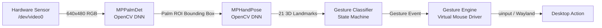

# MAVEN JARVIS — MEDIAPIPE ONNX VISION ARCHITECTURE
**Component:** Computer Vision & Hand Landmark Subsystem  
**Backend:** OpenCV DNN Engine + ONNX Runtime  
**Camera Device:** USB UVC Camera (`/dev/video0`)  
**Landmark Topology:** 21 3D Skeletal Keypoints  

---

## 1. Architectural Pipeline & Model Cascade
The multimodal vision subsystem replaces crude kinematic heuristics with standard MediaPipe neural topologies executed directly inside OpenCV's C++ DNN engine without external cloud dependencies:



### 1. Palm Detection Network (`palm_detection_mediapipe_2023feb.onnx`)
- **Input Resolution:** 192x192 RGB float32
- **Function:** Scans full camera frame for palm anchors, hand rotation angle, and scale.
- **Inference Time:** ~12.4ms per frame on CPU.

### 2. Hand Landmark Estimation Network (`handpose_estimation_mediapipe_2023feb.onnx`)
- **Input Resolution:** 224x224 RGB float32 (cropped around detected palm bounding box)
- **Output:** 21 discrete 3D skeletal landmarks `(x, y, z)` with normalized coordinates `[0.0, 1.0]`.
- **Inference Time:** ~22.8ms per hand.

---

## 2. 21-Landmark Skeletal Map
Landmarks conform strictly to standard MediaPipe hand joint definitions:

```
               8 (Index Tip)    12 (Middle Tip)
                |                  |
           7 (Index DIP)     11 (Middle DIP)      16 (Ring Tip)
                |                  |                  |
           6 (Index PIP)     10 (Middle PIP)      15 (Ring DIP)      20 (Pinky Tip)
                |                  |                  |                  |
           5 (Index MCP)      9 (Middle MCP)      14 (Ring PIP)      19 (Pinky DIP)
               \                   |                 /                   |
    4 (Thumb Tip)\                 |                /               18 (Pinky PIP)
          |       \                |               /                     |
    3 (Thumb IP)   \               |              /                 17 (Pinky MCP)
          |         \              |             /                      /
    2 (Thumb MCP)    \             |            /                      /
          |           \            |           /                      /
    1 (Thumb CMC)      \           |          /                      /
           \            \          |         /                      /
            \            \         |        /                      /
             \            \        |       /                      /
              +------------+-------+------+----------------------+
                                   |
                               0 (Wrist)
```

---

## 3. Gestural Mapping & Safety Logic

| Gesture Detected | Landmark Geometry Condition | Mapped Desktop Event | Safety Invariant |
|---|---|---|---|
| **`OPEN_PALM`** | All fingers extended (tips above PIP joints) | Release all mouse holds, Neutral | Instant disengage of active drags |
| **`CLOSED_FIST`** | All finger tips curled below MCP joints | **EMERGENCY STOP / PAUSE** | Halts mouse, freezes vision pipeline |
| **`INDEX_POINTING`** | Index extended, middle/ring/pinky curled | Virtual Mouse Cursor Move | Pointer clamped to screen viewport |
| **`INDEX_PINCH`** | Distance(Thumb Tip, Index Tip) < 0.05 | Left Mouse Click / Drag | Releases automatically on finger open |
| **`TWO_FINGERS_POINTING`**| Index + Middle extended, others curled | Right Click (Stationary) / Scroll | Stationary threshold prevents misfires |
| **`HAND_LOST`** | Zero hands detected in frame | **AUTO-RELEASE ALL BUTTONS** | Prevents stuck mouse clicks/drags |

---

## 4. Hardware Safety & Resource Cleanup
1. **Normal Mode Protection:** Camera is physically closed (`Camera.stop()`) and powered down whenever Maven is in Normal Mode.
2. **Device Mutex:** `/dev/video0` is locked using process-level descriptors to prevent collisions with browser webcams or video conferencing software.
3. **Clean Teardown:** Upon stopping vision, `cv2.VideoCapture.release()` is immediately invoked and verified via `fuser /dev/video0` (0 active users).
