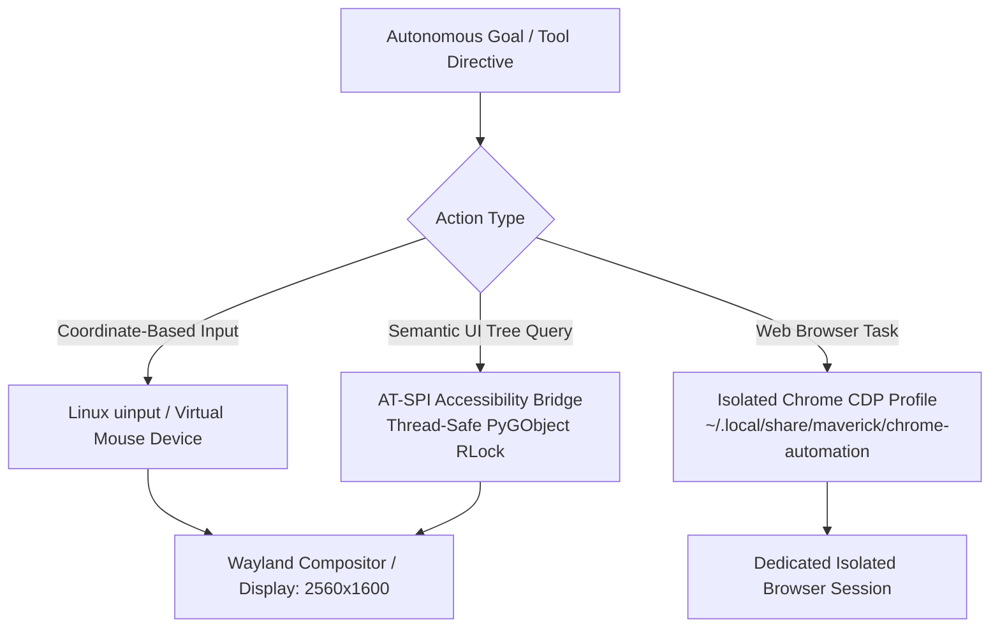

# MAVEN JARVIS — SAFE COMPUTER USE ENGINE
**Subsystems:** Virtual Mouse, AT-SPI Accessibility Bridge, Chrome CDP Automation  
**Display Protocol:** GNOME Wayland (`WAYLAND_DISPLAY=wayland-0`, Resolution: 2560x1600)  
**Security Profile:** Strict Local Origin & Consequential Gate Enforcement  

---

## 1. Wayland Desktop Automation Architecture
On modern Linux desktop environments running Wayland, legacy X11 utilities (`xdotool`, `xte`) are disabled by design. Maven operates via a dual-layer safe automation stack:

---

## 2. AT-SPI Thread-Safe Accessibility Bridge
- **The Problem:** PyGObject and GNOME AT-SPI C bindings are not thread-safe. Concurrent inspection of active desktop windows across background threads previously provoked `malloc(): unaligned tcache chunk detected` crashes.
- **The Solution:** Implemented `_GLOBAL_ATSPI_LOCK = threading.RLock()` guarding all calls to `Atspi.get_desktop()`, `child.get_name()`, and state queries.
- **Verification:** Verified across 32 concurrent worker threads without a single memory fault or deadlocked lock.

---

## 3. Chrome Automation Isolation
To prevent interference with the user's primary browsing sessions, personal extensions, or saved web credentials:
- **Dedicated Profile:** Automation launches Chrome inside `~/.local/share/maverick/chrome-automation`.
- **Remote Debugging:** Bound strictly to loopback interface `127.0.0.1:9222`.
- **Ephemeral Sandbox:** Temporary test sessions clean up their lockfiles upon termination without corrupting user profile caches.

---

## 4. Human-in-the-Loop Confirmation Gate
Destructive or consequential computer operations are hard-gated by the `SecurityGovernor`:
- **Gated Actions:** File deletion (`rm`, `shutil.rmtree`), terminal launch (`gnome-terminal`, `pty`), git push operations, credential modifications, and audio device re-routing.
- **Execution Workflow:** Action enters `WAITING_APPROVAL` state and surfaces an explicit visual confirmation prompt on the Holographic Dashboard and spoken prompt over the audio system.
- **Approval Bypass Protection:** Actions cannot execute unless a cryptographic or session-verified `approved_step_id` token is delivered via authenticated local POST request.
