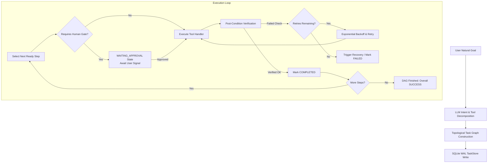

# MAVEN JARVIS — DAG TASK PLANNER & RECOVERY REPORT
**Subsystem:** Autonomous Intelligence Layer (`maverick/intelligence/planner.py`)  
**Storage Engine:** SQLite 3 with Write-Ahead Logging (WAL) Mode  
**Execution Paradigm:** Topological Directed Acyclic Graph (DAG) with Post-Condition Verification  

---

## 1. Multi-Step DAG Planning Engine
The autonomous task planner decomposes complex natural-language user instructions into dependency graphs with strict execution ordering and validation gates:

---

## 2. Invariants & Post-Condition Verification
To eliminate "hallucinated completions" (where an agent reports success despite no actual work occurring):
1. **Physical Artifact Verification:** If a step specifies `document_generate` at `/path/to/doc.pdf`, the engine verifies:
   - File exists on disk.
   - File size > 0 bytes.
   - Magic bytes match `%PDF-` and `%%EOF` exists in the last 48 bytes.
2. **Deterministic Step Dependencies:** Step 2 cannot begin execution until Step 1's post-condition passes.
3. **Recovery Rollback:** In the event of unrecoverable failure, previous staging modifications are safely cleaned up.

---

## 3. SQLite WAL Persistence & Crash Recovery
- **Database Location:** `~/.local/share/maverick/task_store.db`
- **Concurrency Mode:** `PRAGMA journal_mode=WAL; PRAGMA synchronous=NORMAL;`
- **Crash Resilience:** If the Maven process is forcibly killed (`kill -9`) mid-execution, re-launching `AutonomousPlanner` detects dangling `IN_PROGRESS` steps, inspects on-disk artifacts, and resumes execution seamlessly from the last verified checkpoint.
- **Test Verification:** Verified by `tests/test_dag_restart_recovery.py` and `tests/test_dag_failure_handling.py` (100% pass rate).
