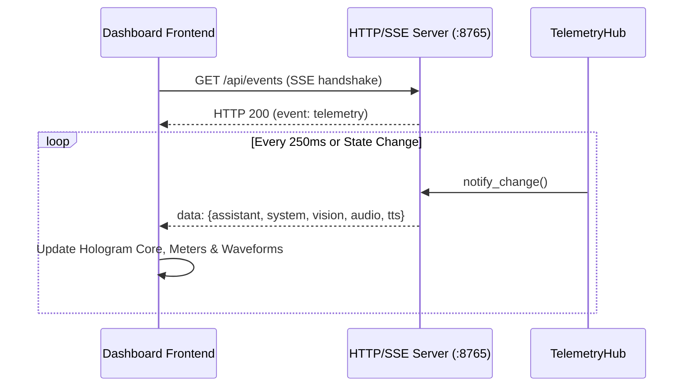

# MAVEN JARVIS — HOLOGRAPHIC DASHBOARD & SSE TELEMETRY
**Component:** Operator Control Center (`maverick/dashboard/server.py`)  
**Network Binding:** `127.0.0.1:8765` (Strict Loopback Only)  
**Real-Time Transport:** Server-Sent Events (SSE) `/api/events`  
**Frontend Architecture:** Modern Holographic HUD with Vanilla JS Web Audio FFT Visualizer  

---

## 1. Real-Time Telemetry & SSE Streaming
The Holographic Control Center streams operational state updates using low-overhead Server-Sent Events (`text/event-stream`):

### Telemetry Payload Structure:
- `assistant`: daemon PID, RSS RAM, CPU usage, VAD status, visual state (`idle`, `listening`, `thinking`, `speaking`, `error`).
- `system`: Per-core CPU load, system RAM, battery charge status, network traffic.
- `audio`: Microphone active/muted, Whisper STT readiness, PipeWire default sinks.
- `vision`: Active mode (`normal` vs `vision_active`), detected hands count, active gesture.
- `computer_use`: Virtual mouse lock status, active profile, pending confirmation gates.

---

## 2. Interactive REST API Endpoints
All modifying actions are protected by strict local origin validation (`Origin: 127.0.0.1` or `localhost`):

| Endpoint | Method | Action Description |
|---|---|---|
| `/api/status` | GET | Instant system state snapshot |
| `/api/system/diagnostics`| GET | Comprehensive hardware, services health, and sanitized processes |
| `/api/voice/voices` | GET | Catalog of offline neural and cloud voices |
| `/api/voice/test` | POST | Preview speech synthesis with Web Audio streaming or host audio |
| `/api/voice/stream/<tok>`| GET | Ephemeral MP3/WAV playback buffer for Web Audio FFT sync |
| `/api/vision/test-camera`| POST | Enumerate camera and capture single verification test frame |
| `/api/vision/test-gesture`| POST | Run single-frame gesture inference test |
| `/api/emergency-stop` | POST | **Master Stop:** Halts mouse, gestures, speech synthesis, and active plans |
| `/api/intelligence/cancel`| POST | Cancel current in-flight autonomous DAG plan |
| `/api/toolkit/document` | POST | Generate PDF, DOCX, or Markdown document on disk |
| `/api/toolkit/code` | POST | Search symbols or grep patterns across codebase |

---

## 3. Web Audio FFT Core & Browser Waveform Sync
When synthesizing voice preview via the dashboard:
1. Audio is streamed as PCM WAV/MP3 to `/api/voice/stream/<token>`.
2. The browser's `AudioContext` connects the audio node to an `AnalyserNode` (FFT size 256).
3. The Holographic Core canvas pulses in real-time synchronization with Maven's actual voice acoustics.
