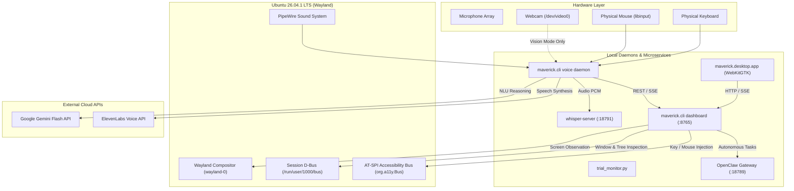

# Maven JARVIS — Integration & Dependency Map
**Complete Mapping of Operating System APIs, Sockets, IPC, and External Services**
*Document Version: 1.0.0 | Date: October 31, 2026 | Environment: Ubuntu 26.04.1 LTS (Wayland)*

---

## 1. Executive Summary

Maven JARVIS interfaces deeply with the Linux operating system, utilizing GNOME accessibility protocols, display server APIs, multimedia audio frameworks, and local loopback microservices. Unlike standard containerized or web-only agents, Maven functions as an authentic native desktop system component.

This document maps all integration layers, IPC channels, system libraries, and remote APIs powering Maven.

---

## 2. Desktop & OS System Architecture Map

---

## 3. Dependency & Integration Inventory

### 3.1 Operating System & Desktop Subsystems
| Subsystem / Interface | API / Channel | Consumer Module | Integration Purpose |
| :--- | :--- | :--- | :--- |
| **GNOME AT-SPI 2.0** | D-Bus `/org/a11y/bus` | `maverick/vision/virtual_input.py`, `maverick/computer_use/accessibility.py` | Native pointer movement, clicking, scrolling, and typing without root permissions; semantic UI tree extraction. |
| **PipeWire / ALSA** | Audio PCM Stream | `maverick/voice/audio.py` | Low-latency audio capture for wake-word and Whisper STT. |
| **WebKit2GTK 4.1 & Gtk 3.0** | PyGObject (`gi.repository`) | `maverick/desktop/app.py` | Native Ubuntu desktop application window, dark headerbar, and persistent tray/window lifecycle. |
| **Wayland Compositor** | `grim` CLI / XDG Portal | `maverick/computer_use/screen.py` | High-fidelity screen observation and visual change detection. |
| **Linux input / udev** | `/dev/input/` | `maverick/vision/mode_manager.py` | Physical mouse movement detection for 1.5s virtual input priority pause. |
| **Video4Linux2 (V4L2)**| `/dev/video0` | `maverick/vision/camera.py` | Web camera feed for hand tracking (strictly idle in Normal Mode). |

---

### 3.2 Inter-Process Communication (IPC) & Sockets
All local network communications are strictly isolated to loopback addresses (`127.0.0.1` and `[::1]`):

| Port / Address | Protocol | Provider Process | Consumer Process | Payload & Purpose |
| :--- | :---: | :--- | :--- | :--- |
| **`127.0.0.1:18791`** | HTTP POST | `whisper-server` (C++ binary) | `maverick/voice/stt.py` | 16kHz mono audio WAV $\rightarrow$ Transcribed text string. |
| **`127.0.0.1:8765`** | HTTP / SSE | `maverick/dashboard/server.py` | `maverick.desktop.app`, HUD | REST control endpoints, telemetry streaming, emergency stop. |
| **`127.0.0.1:18789`** | HTTP / WS | OpenClaw Gateway (Node.js) | `maverick/intelligence/` | Multi-agent coordination, memory routing, bearer token auth. |
| **`127.0.0.1:9222`** | Chrome DevTools Protocol | Google Chrome | `maverick/browser/client.py` | Tab manipulation, DOM tree extraction, web navigation. |
| **`/run/user/1000/bus`**| UNIX Domain Socket | `dbus-daemon` (Session Bus) | Desktop awareness, AT-SPI | Desktop state, notification delivery, window tracking. |

---

### 3.3 Python Runtime & Core Libraries
The system utilizes Python 3.14.4 on Ubuntu 26.04.1 LTS with zero fragile non-system dependencies for core operation:

- **`gi.repository` (PyGObject):** Gtk 3.0, Gdk 3.0, WebKit2 4.1, Atspi 2.0, Gio, GLib. Provides native GTK UI and AT-SPI input synthesis.
- **`cv2` (OpenCV 4.x):** Frame capture, YCrCb color space segmentation, distance transform, morphological contour analysis, and wireframe synthesis.
- **`numpy` (NumPy 2.3.5):** Numerical array processing for landmark smoothing, screen diffing, and audio frame analysis.
- **`PIL` (Pillow):** Image processing, visual wireframe composition, and text rendering.
- **`psutil` (psutil 7.1.0):** Kernel CPU, memory, battery, process tree, and file descriptor telemetry.

---

### 3.4 External Cloud Services
- **Google Gemini Flash API (`generativelanguage.googleapis.com`):** Primary conversational intelligence, multi-turn reasoning, and complex intent classification. Communicates via HTTPS over TLS 1.3 with API key authorization.
- **ElevenLabs Speech API (`api.elevenlabs.io`):** High-fidelity voice synthesis streaming. Configured with automatic graceful fallback to local Piper / espeak-ng if network latency exceeds 800ms or connection fails.

---

## 4. Architectural Dependency Strengths & Vulnerabilities

### Strengths:
1. **Zero External Kernel Hooks:** No reliance on custom kernel modules, uinput permissions, or root-level daemons. Operates entirely in unprivileged user space.
2. **Built-in Computer Vision Fallback:** The kinematic hand tracker (`OpenCVKinematicProvider`) executes without requiring neural network runtimes, maintaining full functionality even in barebone environments.
3. **Local Loopback Security:** Absolute loopback containment prevents remote exploitation.

### Vulnerabilities & Recommendations:
1. **Whisper Daemon Process Coupling:** If `whisper-server` is killed, voice requests fail until systemd restarts it. Recommendation: Implement client-side connection pooling with local silence retries.
2. **Missing Binary Probing:** Subprocess execution assumes certain binaries exist (`libreoffice`, `google-chrome`). Recommendation: Add a centralized `DependencyVerifier` utility that dynamically gates tools based on host package availability.
