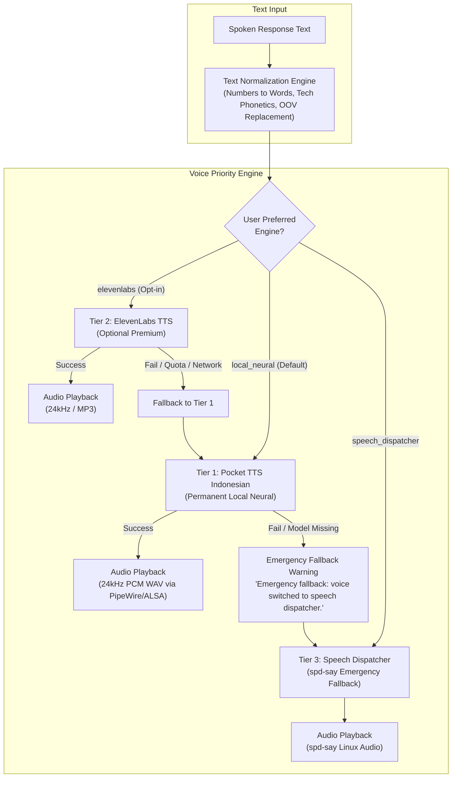

# MAVEN JARVIS — Permanent Natural Voice Architecture

## Executive Summary

To ensure Maven JARVIS operates with a consistent, authoritative, natural-sounding voice identity that never depends on internet connectivity, external cloud credits, or paid third-party APIs, the speech subsystem has been upgraded to a permanent **Three-Tier Voice Architecture**.

The primary engine is now a local neural text-to-speech model running locally on CPU. ElevenLabs remains available exclusively as an optional, explicitly configured premium tier, while Linux Speech Dispatcher serves as an emergency fallback with audible notification.

---

## 1. Three-Tier Provider Hierarchy

### Tier 1 — PRIMARY: Local Indonesian Neural TTS (Permanent Default)
- **Engine:** Pocket-TTS Indonesian 6-Layer Distilled Student Model (`anak10thn/pocket-tts-indonesian`).
- **Base Architecture:** Kyutai CALM autoregressive flow-matching transformer + Mimi 24 kHz neural audio codec.
- **Model Parameters:** ~100M parameters (distilled from 12-layer teacher).
- **Execution Target:** Standard x86_64 CPU (AVX2 optimized).
- **Cost & Dependencies:** 100% offline, zero cloud credits, zero external API keys.
- **Voice Identity:** Persistent across reboots via reference speaker prompt conditioning (`common_voice_id_19961910`).

### Tier 2 — OPTIONAL PREMIUM: ElevenLabs TTS
- **Engine:** ElevenLabs Multilingual v2 API (`eleven_multilingual_v2`).
- **Role:** Explicit user opt-in only via Control Center settings (`tts_engine: "elevenlabs"`).
- **Invariants:**
  - Never silently replaces the permanent local neural default.
  - If unconfigured, quota-exceeded (HTTP 401/429), or network is disconnected, Maven logs telemetry and immediately routes to Tier 1 (Local Neural TTS).

### Tier 3 — EMERGENCY FALLBACK: Linux Speech Dispatcher
- **Engine:** `/usr/bin/spd-say` (espeak-ng / speech-dispatcher daemon).
- **Role:** Safety net of last resort to prevent Maven from going mute if local neural files or environments become corrupt.
- **Quality Degradation Prevention:** Maven speaks an audible warning before the utterance:
  > *"Emergency fallback: voice switched to speech dispatcher."*
- Ensures voice quality is never degraded silently without user awareness.

---

## 2. Text Normalization Pipeline (`maverick.voice.text_normalization`)

Because the Pocket-TTS Indonesian BPE tokenizer has a specialized 4,000-token vocabulary trained on the LEMAS conversational Indonesian dataset, raw text must pass through a strict normalization stage:

1. **Number-to-Words Conversion:**
   - Digits `0-9` are out-of-vocabulary in the BPE tokenizer.
   - All integers, decimals, dates, and percentages are converted into Indonesian words:
     - `15` $\rightarrow$ `lima belas`
     - `95%` $\rightarrow$ `sembilan puluh lima persen`
     - `3.5` $\rightarrow$ `tiga koma lima`
     - `Rp 50.000` $\rightarrow$ `lima puluh ribu rupiah`
2. **Out-of-Vocabulary Symbol Sanitization:**
   - Exclamation marks `!` $\rightarrow$ `.`
   - Hyphens `-` $\rightarrow$ ` ` (space)
   - Slashes `/` $\rightarrow$ ` atau `
   - Symbols `+` $\rightarrow$ ` tambah `, `&` $\rightarrow$ ` dan `, `@` $\rightarrow$ ` at `
3. **English Technical Terminology Phonetic Mapping:**
   - Acronyms expanded for proper Indonesian phonetics: `CPU` $\rightarrow$ `C P U`, `RAM` $\rightarrow$ `R A M`, `API` $\rightarrow$ `A P I`, `JSON` $\rightarrow$ `jeison`, `HTTP` $\rightarrow$ `H T T P`.
   - Technical loan words adapted: `Python` $\rightarrow$ `paiton`, `offline` $\rightarrow$ `oflein`, `cache` $\rightarrow$ `kesh`, `dashboard` $\rightarrow$ `desbor`, `daemon` $\rightarrow$ `demon`.

---

## 3. Storage and Isolation Architecture

All voice model weights, virtual environments, and configuration files are stored strictly outside production directories:

| Component | Path | Purpose |
| :--- | :--- | :--- |
| **Model Weights Cache** | `~/.local/share/maverick/models/tts/pocket-tts-indonesian/` | Cached model safetensors (418 MB), tokenizer (0.3 MB), and voice prompts |
| **Offline Config** | `~/.local/share/maverick/models/tts/pocket-tts-indonesian/indonesian_6l_local.yaml` | Airgapped configuration pointing exclusively to local paths |
| **Voice Prompts** | `~/.local/share/maverick/models/tts/pocket-tts-indonesian/voices/` | Reference voice audio clips for speaker identity conditioning |
| **Isolated Runtime** | `~/.local/share/maverick/tts-env/` | Dedicated Python virtual environment isolated from system Python |
| **Voice Settings** | `~/.config/maverick/voice_settings.json` | User voice identity and engine preferences (mode 0600) |
| **Audio Samples** | `reports/jarvis-evolution/permanent-voice/samples/` | Evaluation WAV files for audio quality inspection |

