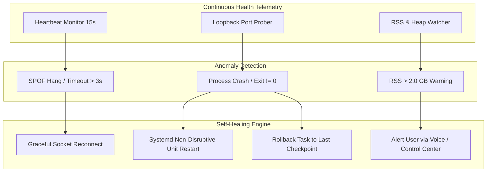

# Maven JARVIS — Reliability & Failure Modes Audit
**Single Points of Failure, Recovery Mechanics & Risk Analysis**
*Document Version: 1.0.0 | Date: October 31, 2026 | Environment: Ubuntu 26.04.1 LTS (Wayland)*

---

## 1. Executive Summary

Autonomous AI operating assistants operating on physical desktop environments face multi-tier reliability hazards: process crashes, asynchronous display server drops, resource starvation, external cloud API degradation, and input device contention. 

This audit maps every identified Single Point of Failure (SPOF), failure mode, and mitigation strategy across Maven JARVIS to establish production-grade operational resilience.

---

## 2. Failure Mode & Effects Analysis (FMEA)

| Subsystem Component | Potential Failure Mode | Root Cause / Trigger | Severity | Likelihood | Current Mitigation | Hardened Target Mitigation |
| :--- | :--- | :--- | :---: | :---: | :--- | :--- |
| **Whisper STT Server** (`:18791`) | Crash or socket timeout | Memory spike / bad PCM frame | **HIGH** | Low | Systemd auto-restart (`Restart=on-failure`) | Local retry loop with exponential backoff + silence frame injection |
| **Voice Daemon** (`maven-voice`) | Hang on audio read | PipeWire audio device reset or unplug | **HIGH** | Low | Process watchdog | Non-blocking ring buffer + device auto-recovery |
| **Control Center API** (`:8765`) | Unresponsive / Thread lock | Blocked subprocess call or AT-SPI lock | **HIGH** | Medium | Multi-threaded HTTP server | Thread pool isolation with 5s hard timeout on system queries |
| **OpenClaw Gateway** (`:18789`) | Out-of-Memory (OOM) | V8 heap caching over long uptimes | **MEDIUM**| Medium | Systemd memory limits | Automated heap garbage collection trigger + RSS threshold restart |
| **Wayland Screen Capture** | `grim` exit code != 0 | Screen locked / Display power saving | **MEDIUM**| Medium | Falls back to black frame / error | Detects lock screen status via logind; pauses automation safely |
| **AT-SPI Accessibility Tree** | RPC timeout / D-Bus disconnect | Target app hung or unresponsive | **HIGH** | Medium | Catches generic Exception | Async AT-SPI query with 2.0s deadline + visual OCR fallback |
| **Virtual Mouse / Input** | Cursor lock / Endless drag | Gesture disconnect during pinch drag | **CRITICAL**| Low | Emergency Stop hook + Open palm release | Hardware watchdog: auto-release virtual buttons after 3.0s idle |
| **Cloud LLM API** (Gemini) | 429 Rate Limit or Network drop | Internet outage / quota saturation | **HIGH** | Medium | Falls back to rule-based parser | Offline local quantized intent fallback + cached response store |
| **Autonomous Task Planner** | Execution loop crash | Unhandled tool exception | **HIGH** | Low | Returns `status: failed` | Automatic checkpointing, rollback compensation, and retry policy |

---

## 3. In-Depth Failure Mode Analysis

### 3.1 Input Device Contention & Race Conditions
- **Symptom:** Physical user moves mouse while autonomous agent or vision gesture is adjusting cursor position.
- **Current Safeguard:** [`maverick/vision/mode_manager.py`](file:///home/firza-ilmi/Maverick-DevOS/maverick/vision/mode_manager.py) implements `PHYSICAL_INPUT_PAUSE_SECONDS = 1.5`. Whenever physical input delta $> 5$ pixels is detected, virtual input is suspended for 1,500ms.
- **Residual Risk:** If virtual input thread issues a `mouseDown` immediately before physical movement, the mouse button might remain logically pressed down if the physical user does not click.
- **Evolutionary Enhancement:** Introduce an **Auto-Release Safety Watchdog** in `VirtualInput` that guarantees any simulated button press is released immediately upon physical input interception.

### 3.2 Wayland Display Server & Window Focus Desynchronization
- **Symptom:** Virtual keyboard sends keystrokes, but target window lost focus due to a system notification or user alt-tab.
- **Current Safeguard:** Active window verification checks window title before typing.
- **Residual Risk:** Rapid window switching between verification and key injection.
- **Evolutionary Enhancement:** Atomic focus verification: capture active window handle immediately before key injection, verify focus state, and abort typing if focus shifted.

### 3.3 Asynchronous AT-SPI Registry Disconnects
- **Symptom:** AT-SPI tree calls raise `dbus.exceptions.DBusException: The name org.a11y.Bus was not provided by any .service files`.
- **Root Cause:** In Wayland environments, accessibility daemon (`at-spi2-registryd`) may restart or fail to start if accessibility is toggled off in GNOME settings.
- **Evolutionary Enhancement:** Add a pre-flight accessibility health check that automatically starts `at-spi2-registryd` via `gio` or falls back seamlessly to pixel-based multimodal vision without raising unhandled errors.

### 3.4 Process Lifecycle & Zombie Mitigation
- **Symptom:** Spawning desktop applications via `subprocess.Popen` without tracking PIDs leaves orphan processes if the parent crashes.
- **Current State:** Applications are launched detached using `setsid`.
- **Evolutionary Enhancement:** Maintain an active Process Registry (`ProcessTracker`) registering PID, process tree, and launch timestamp, ensuring clean termination upon Emergency Stop or system shutdown.

---

## 4. Self-Healing & Recovery Architecture

To ensure 99.9% uptime during extended multi-day autonomous operation:

1. **Dead Man's Switch:** If the main orchestrator becomes unresponsive for $> 10$ seconds, all virtual input is immediately released, and all active automated workflows are paused.
2. **Atomic Rollback:** If a multi-step task fails halfway (e.g. file created but compilation failed), the orchestrator triggers reverse compensation steps registered in the plan DAG.
3. **Graceful Degradation:** If cloud LLM is unreachable, Maven seamlessly downgrades to local keyword-based intent parsing and Piper local TTS without terminating the voice daemon.
