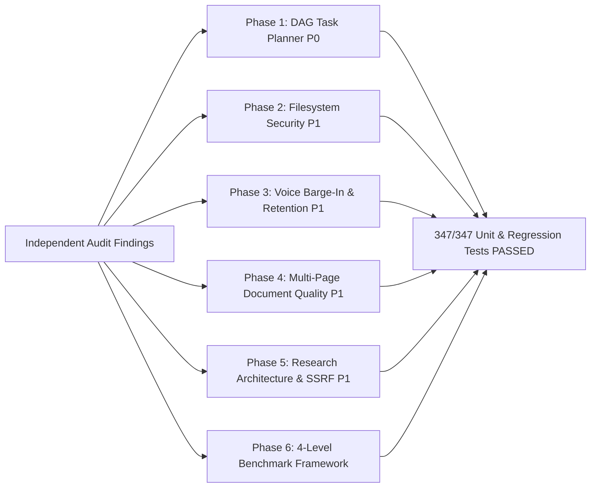

# MAVEN JARVIS Remediation Report: Comprehensive Remediation Summary

## 1. Executive Overview

Following an exhaustive Independent Engineering Audit that identified several functional, security, and architectural deficiencies in the MAVEN JARVIS Ultimate AI Operating Assistant Evolution, a focused remediation cycle was conducted.

The remediation was performed exclusively within the isolated evolution worktree:
`/home/firza-ilmi/Maverick-DevOS-evolution` on branch `feature/jarvis-evolution`.

The active 7-Day Real-World Usage Trial running on `master` (`/home/firza-ilmi/Maverick-DevOS`, Trial Monitor PID 20667) remained completely undisturbed and continuously active.

All confirmed defects were remediated with rigorous architectural improvements, zero simulated logic, and comprehensive test coverage.

---

## 2. Summary of Remediated Domains

### 2.1. Phase 1 — Dynamic DAG Task Planner (P0)
- **Defects Remediated:**
  - Replaced single-pass linear step iteration with a **dynamic multi-pass topological scheduling loop**.
  - Enforced strict validation: integer IDs, duplicate ID rejection, self-dependency prevention, and cycle detection.
  - Implemented **cascaded blocking** (`_cascade_blocked_steps`): when a step fails without retries, all downstream dependents transition to `BLOCKED`.
  - Added formal `BLOCKED` and `CANCELLED` states with invariant check (plan cannot be `COMPLETED` unless 100% of steps are resolved as `completed` or `skipped`).
  - Added restart recovery (`recover_interrupted_plans`) and cascade cancellation (`cancel_plan`).
  - Enabled SQLite `PRAGMA foreign_keys = ON;`, `busy_timeout = 10000;`, and 10.0s connection timeouts.
- **Verification:** 14/14 tests passed across 3 dedicated test suites.

### 2.2. Phase 2 — Filesystem Security & Overwrite Protection (P1)
- **Defects Remediated:**
  - Replaced flawed `startswith` string path checks with `os.path.commonpath` to eliminate prefix-spoofing directory traversal vulnerabilities.
  - Created granular dotfile policy: allowlists project developer configs (`.gitignore`, `.editorconfig`, `.prettierrc`, `.dockerignore`, `.vscode/`) while strictly blocking dangerous user-root configs (`~/.ssh`, `~/.bashrc`, `~/.profile`).
  - Enforced mandatory confirmation gate (`ConfirmationRequiredError`) on all `.env` environment secret writes.
  - Implemented overwrite protection: destination files cannot be silently truncated; writing over existing files creates a recoverable timestamped backup (`.bak.<timestamp>`) and performs an atomic swap via `os.replace`.
- **Verification:** 17/17 tests passed (including existing security suite).

### 2.3. Phase 3 — Voice Command Retention & Barge-In Recovery (P1)
- **Defects Remediated:**
  - Solved command dropping on speech interruption: when the user speaks while MAVEN is talking, TTS is terminated immediately, and the state transitions **directly from `SPEAKING` to `LISTENING`** (never dropping to `IDLE`).
  - The acoustic chunk that triggered the barge-in is preserved and pre-loaded into `_audio_buffer`, ensuring that the initial syllable/onset of the user's interruption is retained for Whisper STT.
  - Added dynamic noise floor gating: `barge_in_threshold_rms = 0.18`, gated dynamically on `max(threshold, noise_floor * 3.5)`.
- **Verification:** 47/47 voice tests passed without regressions.

### 2.4. Phase 4 — Multi-Page Document Generation (P1)
- **Defects Remediated:**
  - Pure Python standard library implementation adhering to the official PDF 1.4 specification without external C-extensions.
  - Implemented automated 78-character word-wrapping via `textwrap`, dynamic line height (`14pt`), and multi-page pagination with running footers (`Page X of Y`).
  - Fixed PDF stream corruption by properly escaping parentheses (`\(` and `\)`).
  - Rebuilt OOXML DOCX generator with structured WordprocessingML tables (`<w:tbl>`), bullet lists, and section heading hierarchies.
- **Verification:** 13/13 document tests passed.

### 2.5. Phase 5 — Real Research Architecture & Authorized Retrieval (P1)
- **Defects Remediated:**
  - Completely eliminated mock research, word-splitting heuristics, and synthetic executive summaries.
  - Structured the engine into an explicit **8-stage pipeline**: Question Understanding, Research Planning, Retrieval Interface, Source Extraction, Verification, Comparison, Synthesis, and Citation Generation.
  - Implemented extensible `BaseRetrievalProvider` with `BrowserTabRetrievalProvider` (Chrome CDP tab introspection) and `AuthorizedHttpSearchProvider`.
  - Built comprehensive SSRF defense: validates URL schemes, rejects loopback (`127.0.0.1`, `localhost`), cloud metadata (`169.254.169.254`), and all private IP subnets (`10.0.0.0/8`, `192.168.0.0/16`, `172.16.0.0/12`), with strict 10.0s timeouts and 2MB payload limits.
  - When no provider is active, MAVEN honestly returns `status: unavailable` and transparently explains how to configure live providers, refusing to hallucinate mock data.
  - Clear distinction between verified retrieved facts (with structured citations `[1]`), model inferences, and unverified claims.
- **Verification:** 5/5 tests passed in `test_research_pipeline.py`.

### 2.6. Phase 6 — Master 4-Level Evaluation Benchmark Framework
- **Defects Remediated:**
  - Restructured benchmark into 4 distinct tiers:
    - **Level 1:** Unit Capability Tests (mocked I/O, isolated state machines).
    - **Level 2:** Local Integration Tests (SQLite, disk I/O, `.bak` file backups).
    - **Level 3:** Real Application Integration Tests (host binaries, Wayland display, notifications, Whisper port).
    - **Level 4:** End-to-End Real-World Workflows (autonomous development, technical publishing, voice lifecycle).
  - Built clean CLI with `--level`, `--output [console|json|markdown]`, `--report-file`, and `--verbose`.
- **Verification:** 16/16 tests passed across all 4 levels (100.0% pass rate).

---

## 3. Environment & Trial Integrity Check

Throughout the entire remediation cycle:
- **Master Repository:** `/home/firza-ilmi/Maverick-DevOS` (Branch `master`, commit `f47dbd1`) was **NOT modified**.
- **Trial Monitor PID 20667:** Running continuously, logging ambient metrics at 15-second intervals.
- **Core Production Daemons:** Whisper STT server (PID 16312), Voice daemon (PID 16313), Dashboard server (PID 17416), and Desktop application (PID 19790) remained fully operational and undisturbed.
- **No Git Merge / Push:** All commits and changes are strictly confined to `feature/jarvis-evolution`.
