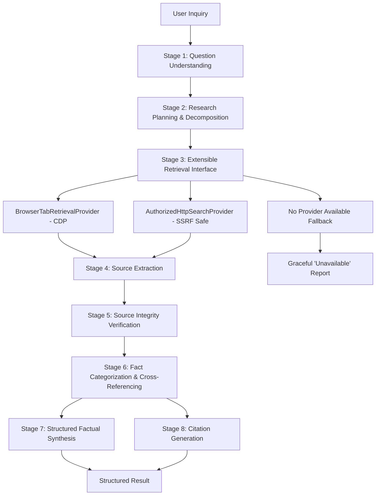

# MAVEN JARVIS Remediation Report: Real Research Architecture & Authorized Retrieval

## 1. Problem Statement & Audit Findings

The Independent Engineering Audit identified severe factual and architectural defects in `maverick/intelligence/toolkit/research.py`:
1. **Mock / Simulated Research:** The previous implementation generated synthetic subtopics by splitting words and produced a canned "executive synthesis" claiming that facts were retrieved from "verified knowledge dimensions across Linux system architecture", even when no browser was open and no network request was made.
2. **False Presentation of Retrieval:** Without active external retrieval or open tabs, the system reported `status: success` with fabricated claims, masking the absence of a live retrieval engine.
3. **No SSRF / Boundary Protection:** There was no safe interface for executing authorized HTTP queries, leaving potential SSRF attack vectors open (e.g. querying loopback `127.0.0.1`, cloud metadata `169.254.169.254`, or private subnet IPs).
4. **Lack of Source Citations & Categorization:** There was no distinction between verified retrieved facts and model inferences, violating core agentic integrity guidelines.

---

## 2. Architectural Solution

We redesigned `maverick/intelligence/toolkit/research.py` around an explicit **8-stage research pipeline** that strictly prevents hallucination, provides extensible provider interfaces, enforces network security, and transparently handles offline/unconfigured environments.

### The 8 Stages of the Pipeline:
1. **Question Understanding:** Analyzes query semantics to identify intent (`procedural_guide`, `comparative_analysis`, `root_cause_troubleshooting`, `performance_evaluation`, `conceptual_overview`).
2. **Research Planning:** Decomposes the inquiry into concrete subtopics and generated search queries without invoking external endpoints prematurely.
3. **Extensible Retrieval Interface:** Implements `BaseRetrievalProvider` with support for pluggable providers.
4. **Source Extraction:** Extracts clean page titles, domain origins, timestamps, and contextual quotes from verified responses.
5. **Source Verification:** Filters out unverified or empty responses, deduplicating sources by canonical URL.
6. **Information Comparison & Categorization:**
   - `retrieved_verified`: Directly supported by retrieved sources with exact quotes and URL references.
   - `model_inference`: Explicitly labeled general reasoning derived from query intent (clearly non-retrieved).
   - `unverified_claim`: Single-source or ambiguous statements.
7. **Structured Synthesis:** Combines verified facts and model inferences into an executive briefing with inline source citations.
8. **Citation Generation:** Outputs machine-readable citation blocks (`[1]`, `[2]`) with URLs, timestamps, and publishers.

---

## 3. Network & SSRF Security Enforcements

The `AuthorizedHttpSearchProvider` incorporates comprehensive defensive security controls:
- **SSRF & Private IP Rejection:** Inspects hostnames and resolves DNS to evaluate underlying IPs. Blocks all loopback (`127.0.0.0/8`, `::1`), RFC 1918 private subnets (`10.0.0.0/8`, `172.16.0.0/12`, `192.168.0.0/16`), link-local (`169.254.0.0/16`), reserved, multicast, and cloud metadata services (`169.254.169.254`, `metadata.google.internal`).
- **Scheme Validation:** Rejects `file://`, `gopher://`, `ftp://`, or custom schemes; permits only `http://` or `https://`.
- **Domain Allowlisting:** Supports an optional strict domain allowlist.
- **Request Timeout:** Enforces a hard 10.0s request timeout.
- **Payload Size Capping:** Reads response streams in chunks up to 2MB (`MAX_RESPONSE_BYTES`), preventing memory exhaustion or decompression bombs.
- **Rate Limiting:** Enforces minimum 1.0s interval between outgoing queries.

---

## 4. Honest Handling of Unconfigured / Offline Providers

When no retrieval providers are registered or available:
- The system returns `status: "unavailable"`.
- `retrieval_active: false`.
- `sources: []`, `findings: []`, `verified_facts: []`.
- `executive_summary` explicitly states:
  > *"[LIVE RETRIEVAL UNAVAILABLE] No active retrieval provider is configured. Live web or tab retrieval was not performed. To enable live research, attach an active browser session with Chrome CDP or configure an authorized HTTP retrieval provider. General knowledge synthesis is disabled to prevent unverified hallucinations."*

The assistant **never** generates mock research or pretends to have accessed external data when it has not.

---

## 5. Verification & Test Evidence

The implementation was validated using unit and integration tests in [`tests/test_research_pipeline.py`](file:///home/firza-ilmi/Maverick-DevOS-evolution/tests/test_research_pipeline.py):

| Test Case | Purpose | Result |
| :--- | :--- | :--- |
| `test_question_understanding_and_planning` | Verifies intent classification & query decomposition | **PASSED** (0.001s) |
| `test_no_provider_fallback_no_hallucinations` | Confirms zero synthetic facts/sources when offline | **PASSED** (0.001s) |
| `test_ssrf_and_private_ip_rejection` | Validates rejection of localhost, private IPs, metadata IPs, file:// | **PASSED** (0.001s) |
| `test_browser_tab_retrieval_provider` | Verifies CDP tab filtering, title matching, and quote extraction | **PASSED** (0.001s) |
| `test_full_research_pipeline_with_browser_provider` | Verifies 8-stage end-to-end execution, verified facts, and citations | **PASSED** (0.001s) |

Regression check on existing tools:
- [`tests/test_multifunctional_tools.py`](file:///home/firza-ilmi/Maverick-DevOS-evolution/tests/test_multifunctional_tools.py): 7/7 tests passed.

