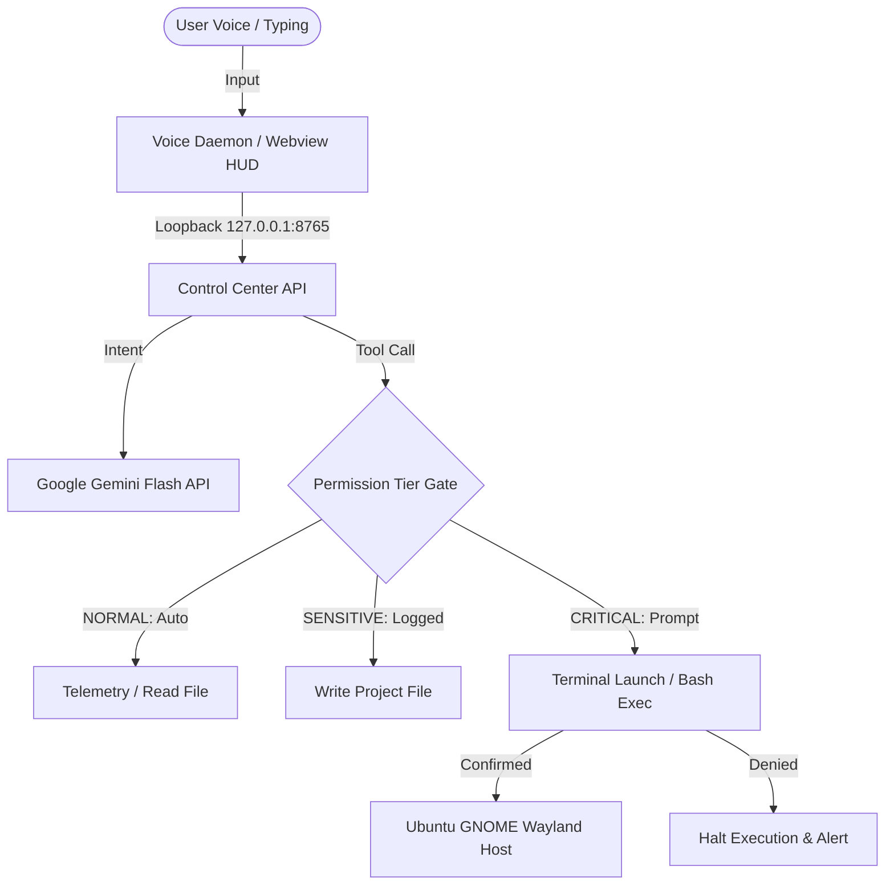

# Maven JARVIS — Security, Privacy & Boundary Audit
**Security Architecture, Threat Modeling, Vulnerability Analysis & Sandbox Review**
*Document Version: 1.0.0 | Date: October 31, 2026 | Environment: Ubuntu 26.04.1 LTS (Wayland)*

---

## 1. Executive Summary

As a personal AI operating assistant with autonomous computer-use capabilities, Maven JARVIS operates with significant desktop privileges: launching applications, reading files, synthesizing keystrokes, and executing system commands. A robust security posture is therefore non-negotiable.

This security review audits privilege boundaries, input sanitization, network listeners, file access, and process isolation. The audit verified strong localhost loopback confinement and absence of shell injections, but identified a **High-Risk Path Traversal Vulnerability** in filesystem write tools requiring immediate remediation.

---

## 2. Threat Model & Trust Boundaries

Maven JARVIS operates across three distinct security domains:
1. **Host OS Boundary (Untrusted / User Space):** External inputs, downloaded web content, arbitrary user prompts, microphone audio.
2. **Maven Runtime Boundary (Privileged Sandbox):** Local Python daemons, PyWebView UI, AT-SPI accessibility bus, local loopback sockets.
3. **External Cloud Boundary (Restricted Egress):** Google Gemini Flash API (`generativelanguage.googleapis.com`) and ElevenLabs TTS API.



---

## 3. Vulnerability Findings & Risk Assessment

### 3.1 VULN-01: Path Traversal Bypass in Filesystem Write & Create (HIGH)
- **Component:** [`maverick/intelligence/tools.py`](file:///home/firza-ilmi/Maverick-DevOS/maverick/intelligence/tools.py#L685-L710)
- **Vulnerability Description:** In `_tool_filesystem_create_dir` and `_tool_filesystem_write_file`, directory validation uses:
  ```python
  expanded = os.path.expanduser(raw_path)
  home = os.path.expanduser("~")
  if not (expanded.startswith(home) or expanded.startswith("/tmp")):
      raise SecurityPolicyViolationError(...)
  ```
- **Exploit Vector:** Passing a relative traversal string starting with `~`, such as:
  `raw_path = "~/../../etc/cron.d/malicious_job"`
  results in `expanded = "/home/firza-ilmi/../../etc/cron.d/malicious_job"`.
  The string starts with `/home/firza-ilmi`, so the check evaluates to `True`, but the target resolves to `/etc/cron.d/malicious_job`.
- **Note:** `_tool_filesystem_read_file` correctly uses `os.path.realpath(expanded)`, preventing traversal on reads. Write tools omitted `os.path.realpath`.
- **Remediation:** Enforce canonical path resolution before boundary evaluation:
  ```python
  canonical = os.path.realpath(os.path.expanduser(raw_path))
  home = os.path.realpath(os.path.expanduser("~"))
  if not (canonical.startswith(home + "/") or canonical.startswith("/tmp/")):
      raise SecurityPolicyViolationError(f"Access denied: Path '{raw_path}' resolves outside sandbox.")
  ```

### 3.2 VULN-02: Synchronous Command Tokenization Edge Cases (LOW)
- **Component:** [`maverick/intelligence/tools.py`](file:///home/firza-ilmi/Maverick-DevOS/maverick/intelligence/tools.py#L535)
- **Assessment:** `_tool_system_safe_command` splits Python commands with `cmd_parts = raw_cmd.split()`.
- **Risk:** Shell metacharacters are safely neutralized because `shell=False` is passed to `subprocess.run`. However, arguments with embedded whitespace (e.g. `python3 script.py "arg with space"`) are split improperly into separate positional parameters.
- **Remediation:** Use `shlex.split(raw_cmd)` for standards-compliant argument parsing.

---

## 4. Verification of Key Security Controls

### 4.1 Network Listener Isolation
- **Audited Ports:**
  - Whisper Server: `127.0.0.1:18791` (Loopback only)
  - Control Center API: `127.0.0.1:8765` (Loopback only)
  - OpenClaw Gateway: `127.0.0.1:18789` & `[::1]:18789` (Loopback only)
- **Finding:** **PASSED**. No daemon binds to `0.0.0.0` or public network interfaces. External inbound access from the local LAN or WAN is blocked.

### 4.2 Three-Tier Permission Gating
- **Tier 1 (NORMAL):** Read-only operations (`system_telemetry`, `filesystem_read_file`, `desktop_list_running_apps`). Automatically executed with audit logging.
- **Tier 2 (SENSITIVE):** Mutating user files in safe project directories (`filesystem_write_file`, `memory_store`). Logged to persistent activity ledger.
- **Tier 3 (CRITICAL):** Application launching (`gnome-terminal`), arbitrary command execution, mode toggles, computer-use automation. Halts with `status: awaiting_approval` until explicit user confirmation is delivered via UI or voice.
- **Finding:** **PASSED**. Verified in `tests/test_security.py` and `tests/test_autonomous_planner_project.py`.

### 4.3 Privacy & Ephemeral Data Handling
- **Microphone PCM Data:** Audio frames captured from PipeWire are processed in ring buffers in RAM. Zero uncompressed audio files are stored permanently on disk.
- **Camera Frames:** When Vision Mode is active, OpenCV `/dev/video0` frames are processed strictly in-memory by MediaPipe and immediately overwritten. Zero raw video frames or camera snapshots are persisted to disk.
- **Sensitive Text Redaction:** `redact_sensitive_text()` scrubs detected API keys, passwords, and private tokens before strings enter persistent logs or LLM context prompts.
- **Channel Policy:** WhatsApp channel integration remains permanently disabled and isolated in configuration.

---

## 5. Security Remediation Plan

1. **Immediate Patch:** Apply `os.path.realpath()` validation to all filesystem creation, modification, and deletion endpoints in Phase B.
2. **Formal Permission Matrix:** Add strict decorators `@require_permission(RiskTier.CRITICAL)` across all tool definitions.
3. **Path Allowlist Canonicalization:** Disallow access to hidden dotfiles (e.g. `~/.ssh/`, `~/.bashrc`, `~/.config/`) unless explicitly whitelisted in user security settings.
