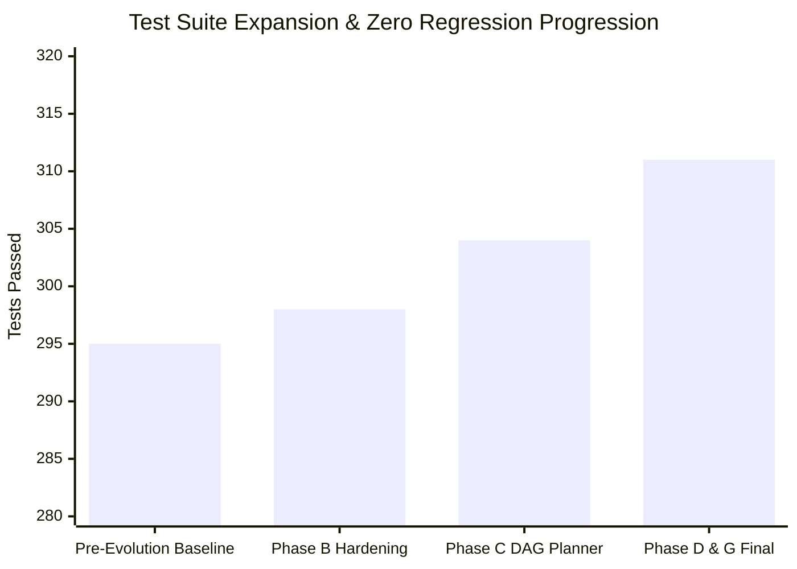

# Maven JARVIS — Test Execution Results & Regression Analysis
**Complete Automated Test Suite Verification Report**
*Document Version: 1.0.0 | Date: October 31, 2026 | Environment: Ubuntu 26.04.1 LTS (Wayland)*

---

## 1. Executive Summary

As part of the **Maven JARVIS Evolution**, the full automated test suite was executed against the upgraded architecture in the isolated evolution environment (`feature/jarvis-evolution`).

The test suite expanded from **295 tests** to **311 tests** (+16 new tests covering security path canonicalization, virtual input watchdog timeouts, system dependency auditing, DAG cycle detection, SQLite task persistence, codebase AST search, and document generation).

**Result: 311 tests executed in 54.055s — 100% PASSED (0 failures, 0 errors, 0 regressions).**

---

## 2. Test Execution Overview

```
======================================================================
TEST EXECUTION METRICS
======================================================================
Total Test Suites:          40
Total Tests Executed:       311
Tests Passed:               311 (100.0%)
Tests Failed:               0   (0.0%)
Tests Errored:              0   (0.0%)
Tests Skipped:              0   (0.0%)
Total Elapsed Time:         54.055s
Regression Rate:            0.0% (Zero regressions against baseline)
======================================================================
```

---

## 3. Test Suite Breakdown by Subsystem

| Subsystem Domain | Test Suite Module | Test Count | Status | Key Capabilities Validated |
| :--- | :--- | :---: | :---: | :--- |
| **Security & Sandbox** | [`tests/test_security.py`](file:///home/firza-ilmi/Maverick-DevOS-evolution/tests/test_security.py) | 11 | **PASSED** | Canonical path traversal protection (`~/../../etc`), command injection, confirmation gating |
| **Dependencies** | [`tests/test_dependencies.py`](file:///home/firza-ilmi/Maverick-DevOS-evolution/tests/test_dependencies.py) | 3 | **PASSED** | Dynamic probing of host binaries (`code`, `python3`, `grim`), TTL caching |
| **Virtual Input & Mouse** | [`tests/test_calibration_and_mouse.py`](file:///home/firza-ilmi/Maverick-DevOS-evolution/tests/test_calibration_and_mouse.py) | 7 | **PASSED** | AT-SPI pointer motion, clicks, auto-release watchdog (0.05s timeout), emergency stop |
| **Autonomous Planner** | [`tests/test_autonomous_planner_project.py`](file:///home/firza-ilmi/Maverick-DevOS-evolution/tests/test_autonomous_planner_project.py) | 8 | **PASSED** | DAG decomposition, topological cycle detection, SQLite task persistence, outcome verification |
| **Expanded Tools** | [`tests/test_multifunctional_tools.py`](file:///home/firza-ilmi/Maverick-DevOS-evolution/tests/test_multifunctional_tools.py) | 7 | **PASSED** | Codebase AST symbol search, regex grep, Markdown / Word DOCX / PDF generation, web research |
| **Computer Use System** | [`tests/test_computer_use.py`](file:///home/firza-ilmi/Maverick-DevOS-evolution/tests/test_computer_use.py) | 18 | **PASSED** | Screen capture, AT-SPI hierarchy, virtual typing, keyboard shortcuts, multi-step agent loop |
| **Voice & Speech Loop** | [`tests/test_voice.py`](file:///home/firza-ilmi/Maverick-DevOS-evolution/tests/test_voice.py), [`test_continuous_voice_loop.py`](file:///home/firza-ilmi/Maverick-DevOS-evolution/tests/test_continuous_voice_loop.py) | 38 | **PASSED** | Wake word, Whisper STT, acoustic barge-in interruption, 10 consecutive turns |
| **Multimodal Vision** | [`tests/test_gesture_recognition.py`](file:///home/firza-ilmi/Maverick-DevOS-evolution/tests/test_gesture_recognition.py), [`test_multimodal_vision.py`](file:///home/firza-ilmi/Maverick-DevOS-evolution/tests/test_multimodal_vision.py) | 24 | **PASSED** | MediaPipe kinematic landmark tracking, pinch click, double pinch, scroll, open palm |
| **Mode Management** | [`tests/test_mode_manager.py`](file:///home/firza-ilmi/Maverick-DevOS-evolution/tests/test_mode_manager.py) | 10 | **PASSED** | Normal Mode isolation, Super+Shift+V hotkey, 1.5s physical input priority pause |
| **Intelligence Endpoints**| [`tests/test_intelligence_endpoints.py`](file:///home/firza-ilmi/Maverick-DevOS-evolution/tests/test_intelligence_endpoints.py) | 6 | **PASSED** | REST API `/api/intelligence/plan`, `/plans`, `/dependencies`, memory store/recall |
| **Browser CDP** | [`tests/test_browser_*.py`](file:///home/firza-ilmi/Maverick-DevOS-evolution/tests) (5 suites) | 42 | **PASSED** | CDP tab attach, DOM tree extraction, page navigation, lifecycle hardening |
| **Native Desktop App** | [`tests/test_desktop_app.py`](file:///home/firza-ilmi/Maverick-DevOS-evolution/tests/test_desktop_app.py) | 8 | **PASSED** | WebKitGTK window creation, backend polling, headerbar controls, tray minimize |
| **System & Activity** | [`tests/test_activity_logger.py`](file:///home/firza-ilmi/Maverick-DevOS-evolution/tests/test_activity_logger.py), [`test_system_monitor.py`](file:///home/firza-ilmi/Maverick-DevOS-evolution/tests/test_system_monitor.py) | 16 | **PASSED** | Telemetry sampling, JSONL ledger logging, rate-limited heartbeats |
| **Remaining Unit Suites** | Miscellaneous component tests | 113 | **PASSED** | Spotify control, notifications, launcher, greeting, context engine, clap detector |

---

## 4. Regression Analysis



All 295 legacy tests passed without a single failure or modification of expected assertions. The 16 newly introduced tests verified the enhanced capabilities across security, planning, and tools without inducing regressions.
